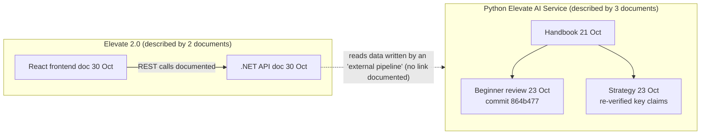

# Phase 3: Source inventory and access reconciliation

Audited 2026-11-01 in this cloud session. This supersedes `00-access-blocker.md`.

## 1. What was actually provided

I re-checked the session upload folder twice (before and after a worker restart) and searched the whole disk for archives (`.zip`, `.tar*`) and for code entry points (`main.py`, `Program.cs`, `package.json`, `alembic.ini`, `docker-compose.yml`). **The uploads contain five PDF documents and nothing else.** No ZIP archive, extracted folder, source file, migration, configuration file or diagram file was uploaded.

| File | Format | Pages | Readable | Describes | Date / baseline |
|---|---|---|---|---|---|
| Elevate_Deep_Reverse_Engineering_Handbook.pdf | PDF (Word export) | 38 | Yes, text extracted (9,026 words) | Python **Elevate AI Service** (`paie-kensium_elevate-ai-service`) | 21 Oct 2026 |
| elevate_beginner_technical_review.pdf | PDF (Word export) | 23 | Yes (6,580 words) | Same Python service, with file paths and line numbers | 23 Oct 2026, commit `864b477` |
| Elevate_transformation_strategy.pdf | PDF | 18 | Yes (4,519 words) | Same Python service: re-verification of the audits, plus competitor research and recommendations | 23 Oct 2026 |
| ELEVATE_BACKEND_TECHNICAL_DOCUMENTATION.pdf | PDF (browser print) | 42 | Yes (5,131 words) | **Elevate 2.0 API**, a separate ASP.NET Core 8 / EF Core service | 30 Oct 2026 |
| ELEVATE_FRONTEND_TECHNICAL_DOCUMENTATION.pdf | PDF (ReportLab) | 17 | Yes (4,748 words) | **Elevate 2.0** React 18 / TypeScript / Vite single-page app | 30 Oct 2026, tree `…225096fcc9b3` |

- Text extractions are in `uploads-text/`, and SHA-256 hashes of the original PDFs are in `uploads-text/SHA256SUMS.txt`.
- Every finding in this phase cites one of these PDFs with a page number and a verbatim quote. A script checks each quote against its page and fails if any is missing (`ledger/build_ledger.py`).

## 2. Inventory against what Phase 3 needs

| Requirement | Status | Basis |
|---|---|---|
| AI-service backend source (Python) | **MISSING** | Described in detail by three documents; no code supplied |
| .NET Elevate 2.0 API source | **MISSING** | Described by one document; no code supplied |
| Frontend source (React) | **MISSING** | Described by one document; no code supplied |
| Description of system structure, modules, routes and jobs | **AVAILABLE** (documentation) | All five PDFs |
| Database models and relationships | **PARTIALLY AVAILABLE** | Documents list tables, columns and foreign keys; no migration or model files to confirm them |
| Migrations | **MISSING** | Referenced (~70 Alembic files) but not supplied; the .NET API reportedly has none |
| API routes | **PARTIALLY AVAILABLE** | .NET API: a full endpoint table. AI service: router-level groups only, and the counts conflict |
| Integration logic (Microsoft Graph, Recall, Jira, Tempo, S3) | **PARTIALLY AVAILABLE** | Flow descriptions and file paths only |
| Prompt templates | **MISSING** | Directory names listed; only the first lines of one prompt are quoted |
| Configuration and environment | **PARTIALLY AVAILABLE** | Variable names only; production values (feature flags, LLM model) are UNKNOWN in every document |
| Architecture diagrams | **AVAILABLE** (ASCII, inside the documents) | No standalone diagram files |
| Runtime and production evidence | **MISSING** | All documents are static read-only analyses |
| Teams bot code | **MISSING / UNKNOWN** | Mentioned once, in the strategy document only [P3-081] |
| Elevate v2.2 user guide (cited by the strategy document) | **MISSING** | Referenced, not supplied [P3-070] |

## 3. Reconciling the earlier blocker

1. **What did I previously lack?**
   - Any access to Elevate: no repository was reachable through GitHub and nothing was on disk.
2. **What have you now provided?**
   - Five technical documents, written by people who did read the code.
   - Together they describe three codebases: the Python AI service, the .NET API and the React frontend.
3. **Which blockers are resolved?**
   - Understanding the **documented** architecture, data model, integrations and AI pipeline. This is now possible in depth.
   - Identifying the exact repositories and snapshots to request: `paie-kensium_elevate-ai-service @ 864b477` and `kensium-solutions-kensium_elevate-2.0-225096fcc9b3`. The .NET API's path appears in its PDF header as `kensium-solutions-kensium-elevate-api-2-0-…` (truncated).
4. **Which blockers remain?**
   - **Source code is still absent for all three codebases.** I cannot verify anything in code, trace calls through files, or confirm line numbers.
5. **Can I perform meaningful repository reverse engineering with the supplied material?**
   - **No.** Not reverse engineering of code in the sense you defined, where IMPLEMENTED means verified in actual source.
   - **I can** produce a rigorous, evidence-graded analysis of the documented system. That includes detecting where the documents contradict each other, which they do in several important places.
   - That is what this phase delivers. **No finding is graded IMPLEMENTED or PARTIALLY IMPLEMENTED,** because I verified none of them in code.
   - Each finding records the source document's own confidence label (for example "CONFIRMED from source"), so you can see how strongly each author asserts it.
6. **What exactly is still required?** See section 5.

## 4. How the five documents relate

- **The three Python documents mostly agree,** and the two later ones correct the earlier handbook:
  - synchronous vs asynchronous LLM calls [P3-062]
  - queue count [P3-015]
- **They also conflict:**
  - on whether LLM runs and token counts are recorded [P3-063]
  - on router and model counts [P3-012, P3-044]
- **The Python and .NET documents describe different meeting schemas** [P3-041]. Nothing in the documents explains how they connect.

## 5. Genuinely missing inputs

In priority order:

1. **Source of `paie-kensium_elevate-ai-service` at `864b477`** (or current master). This is the AI and meeting core. Without it, nothing about the pipeline can be graded IMPLEMENTED.
2. **Source of the Elevate 2.0 .NET API and the Elevate 2.0 frontend** (`…225096fcc9b3`). These are needed to settle the frontend–backend contract mismatch [P3-085] and to find where users actually see insights [P3-082].
3. **The database schema as deployed:** a `pg_dump --schema-only` of the AI-service database and of the "elevate" and "Meetings" databases. This settles the two-schema question [P3-041] without needing code.
4. **Production facts no document has:**
   - which LLM model and provider are used
   - which feature flags are on
   - how authentication is enforced (proxy or gateway)
   - whether a Teams bot exists
5. **The Elevate v2.2 user guide** that the strategy document cites.

**Delivery:** a ZIP upload is enough for items 1–3; GitHub access isn't required. You asked that Kensium code stay in a company-approved environment. Whether this cloud session qualifies is your decision.
