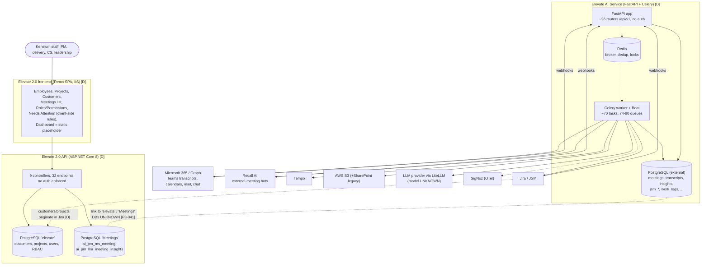
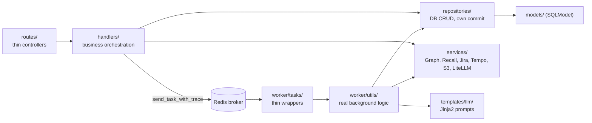

# 01. Current Elevate architecture (as documented)

**Evidence basis:** five documents only; no source code was supplied (see `00`).
- Every element below is **DOCUMENTED ONLY** or **UNKNOWN** in your classification scheme.
- `[P3-nnn]` refers to `08-evidence-ledger.md`, which gives each finding's document, PDF page and verbatim quote.

## 1. The system is three codebases, not one

| Component | Technology (as documented) | Role | Evidence |
|---|---|---|---|
| **Elevate AI Service** (`paie-kensium_elevate-ai-service`) | Python 3.13, FastAPI, Celery 5 + Redis, PostgreSQL (SQLModel/Alembic), LiteLLM, boto3, OpenTelemetry → SigNoz | Meeting capture (Teams and external), transcripts, LLM insights, Jira/JSM and Tempo sync, recording control | [P3-010, P3-013, P3-014] |
| **Elevate 2.0 API** | ASP.NET Core 8, EF Core, two PostgreSQL databases ("elevate", "Meetings"), IIS | Read layer for customers, projects, users, meetings and insights, plus role-based access (RBAC) administration | [P3-019, P3-020, P3-031] |
| **Elevate 2.0 frontend** | React 18, TypeScript, Vite, Zustand, Tailwind, IIS | Leadership/operations UI: employees, projects, customers, meetings, roles and permissions | [P3-033, P3-082, P3-084] |

**What the documents say about how the three connect:**
- The frontend calls the .NET API [P3-082].
- The .NET API says its meeting and insight data is written by an "external pipeline", and it calls no external services itself [P3-020].
- The Python handbook says the AI service is consumed by "the Elevate web frontend (separate repo)". However, the frontend document lists no call to the AI service [P3-082].
- The .NET API reads tables named `ai_pm_ms_meeting` and `ai_pm_llm_meeting_insights`. The Python documents describe `meetings`, `transcripts` and `meeting_insights`, and never mention an `ai_pm_` prefix [P3-041].

**How the three pieces are actually wired together is UNKNOWN.** The diagram below shows only what is documented.

## 2. System context

*Source: `diagrams/01-system-context.mmd`. [D] means documented. Dashed lines are documented origins of data, or unknown links.*

## 3. Module boundaries (AI service, as documented)

*Source: `diagrams/01-ai-service-layers.mmd`. Documented in the handbook (CONFIRMED there) [P3-011].*

## 4. Entry points and request flow

- **AI service:**
  - Docker entrypoint → `alembic upgrade head` → Uvicorn `src.main:app`; Celery worker and Beat run as separate containers [P3-013].
  - Most POST routes queue a Celery task and return 202 at once.
  - Webhook routes handle a Graph validation handshake, de-duplicate in Redis, then queue work [P3-051].
- **.NET API:** minimal hosting `Program.cs`, controllers → DbContext directly, no service layer [P3-019].
- **Frontend:** `main.tsx` → `App.tsx` route table → `ProtectedRoute` (localStorage flag) → pages → `api.ts` fetch wrapper with no auth header [P3-033].

## 5. Background processing

- **Celery:** Redis broker, PostgreSQL result backend, late acks, prefetch 1, one queue per task [P3-014, P3-015].
- **Beat:** 14 periodic jobs [P3-016]:
  - daily Microsoft, Jira and calendar syncs
  - Graph subscription renewal every 6 hours
  - Tempo every 15 and 20 minutes
  - AI-insight scheduler every 2 minutes
  - recording sweeps every 5 minutes
- **Documented reliability edges:**
  - the routing-key mismatch for 14 tasks [P3-017]
  - chord callbacks that can be skipped [P3-018]
  - no retry on the seven insight tasks [P3-064]
  - dedup that fails open if Redis is lost [P3-051]

## 6. Authentication and authorisation

**None of the three components enforces authentication, according to their own documentation:**

| Component | Documented state | Evidence |
|---|---|---|
| AI service | No auth dependency on any route; upstream proxy UNKNOWN | [P3-030] |
| .NET API | No authentication scheme; login does a plain-text string compare and returns the whole user row; RBAC stored but never checked | [P3-031, P3-032, P3-035] |
| Frontend | No Authorization header; session is a localStorage flag; Microsoft 365 sign-in coded but disabled | [P3-033, P3-034] |

**Webhooks:**
- Recall signature verification is commented out [P3-036].
- Jira has no signature check, and Graph `clientState` is not validated [P3-037].

## 7. External dependencies

Microsoft Graph, Recall AI, Jira/JSM, Tempo, AWS S3, an LLM provider through LiteLLM, SigNoz, and a managed PostgreSQL. See `04` for each integration's mechanics.

## 8. What this architecture is not (per the documents)

- **Not multi-tenant:** single-tenant-shaped [P3-049].
- **No retrieval or agents:** no RAG, embeddings, tool-calling or agents; direct LLM completion only [P3-065].
- **No interactive Teams bot evidenced:** only pre-meeting chat notices are documented in code descriptions [P3-081].
- **No implemented management dashboard:** the dashboard page is a placeholder [P3-084].
