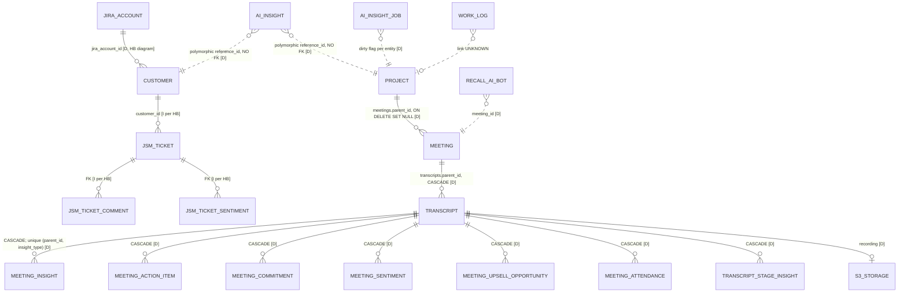
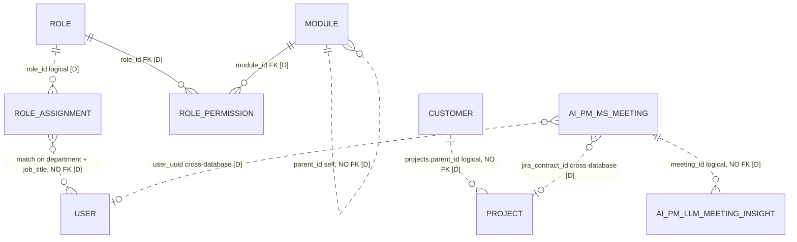

# 03. Database and domain model (as documented)

No schema dump, model files or migrations were supplied. Everything below comes from table and foreign-key listings in the documents. Every entity is **DOCUMENTED ONLY**, and relationships are marked [D] documented or [I] inferred by the source document.

## 1. Technologies
| Store | Engine | Access | Schema management | Evidence |
|---|---|---|---|---|
| AI-service database | PostgreSQL (external, managed) | SQLModel / SQLAlchemy 2.0, psycopg 3; pool 5 + overflow 10 | Alembic, ~70 migrations; `alembic upgrade head` runs on container start | [P3-040, P3-013] |
| "elevate" database | PostgreSQL | EF Core 8 (Npgsql); `permission_type` native enum | **No migrations in the repository**; managed externally | [P3-047] |
| "Meetings" database | PostgreSQL (same host as "elevate") | EF Core 8 | External | [P3-041] |
| Redis | 7.x | Celery broker, de-duplication keys, locks | — | [P3-014, P3-051] |
| S3 | AWS | Recordings, presigned URLs | — | [P3-055] |

## 2. AI-service entities (handbook model list)

**Genuine database tables, per the handbook's model list and its foreign-key table (CONFIRMED there):**
- **Jira-sourced:** `jira_accounts`, `customers`, `projects`, `licenses`, `jsm_tickets`, `jsm_ticket_comments`, `jsm_ticket_sentiments`.
- **Meetings and transcripts:** `meetings`, `transcripts`, `meeting_attendance`, `meeting_recording_override`.
- **Per-transcript AI outputs:** `meeting_insights`, `meeting_action_items`, `meeting_commitments`, `meeting_sentiments`, `meeting_upsell_opportunities`, `transcript_stage_insights`.
- **Cross-entity AI and tracking:** `ai_insights`, `ai_insight_jobs`, `llm_runs`, `alerts`, `needs_attention`, `needs_attention_comments`.
- **Microsoft and identity:** `users`, `tokens`, `calendars`, `ms_subscriptions`, `ms_meeting_chat_notices`, `user_hierarchy`, `user_config`, `roles`, `role_assignments`, `role_permissions`, `modules`.
- **Other integrations and storage:** `recall_ai_bots`, `s3_storage`, `work_logs` (Tempo).
- **Billing:** `billing_duration`, `billing_milestones`, `billing_time_and_material`.
- **Configuration and governance:** `app_config`, `audit_log`, `sensitive_fields`, `sales_discovery_questions`.
- Table names are the handbook's class names converted to tables; the exact names are unverified.
- The model count itself conflicts: 38+, 44 or 45 [P3-044].

**Not database tables:** Pydantic request and response schemas under `src/schemas/`, and LLM response envelopes. These are DTOs, not entities.

### 2.1 Documented relationships

*Source: `diagrams/03-ai-service-er.mmd`. Dotted lines mean no foreign key, or a link that isn't documented.*

**Reading the model:**
- **Customer → Project:** the handbook's ASCII diagram draws an FK from `customers` to `projects`. The direction and column aren't stated in its FK table. It is UNKNOWN whether `projects` reference `customers` by FK.
- **Meetings hang off Projects** (`parent_id`, SET NULL). They are not attached to Customers directly [P3-042].
  - This is the **opposite of Rocketlane's account-level attachment** (Phase 1 D1-033), which is notable.
  - How a meeting gets its `parent_id`, by matching or manually, is not documented.
- **Every AI output hangs off the transcript, not the meeting or the project,** and is deleted with it [P3-042].
- **Summary, minutes and key notes are overwritten** on regeneration because of the unique `(parent_id, insight_type)` key. No version history is documented [P3-046].
- **No ORM `Relationship()` declarations** exist; joins are written by hand [P3-045].
- **`ai_insights` uses a polymorphic `reference_id` with no FK,** so its integrity is not enforced by the database [P3-046].

## 3. Elevate 2.0 (.NET) entities

*Source: `diagrams/03-dotnet-er.mmd`.*

- **Customer** (Jira issue): segment, type, industry, `customer_sentiment` (string), MSA, ERP/e-commerce stack, CSM, sales rep, SharePoint URL.
- **Project** (Jira issue):
  - `parent_issue_key` → customer
  - team roles held as strings (PM, lead, architect, tech lead, QA)
  - `project_health` (string), progress and finance metrics, seven milestone dates
  - **No project-membership table is documented in either system** [P3-048].
- **User:** Microsoft ID, department and job title (which drive RBAC), billing fields (CTC, hourly rate, target hours), `password_hash` compared in plain text [P3-032].

## 4. The two-schema problem
| Concept | AI service (Python documents) | Elevate 2.0 (.NET document) |
|---|---|---|
| Meeting | `meetings` (attendees, join URLs, `parent_id` → project) | `ai_pm_ms_meeting` in database "Meetings" (`jira_contract_id`, attendees[]) |
| Insight | `meeting_insights` (+ six typed tables) keyed to the transcript | `ai_pm_llm_meeting_insights` (`insight_type`, content, `transcript_id`) |
| Customer / project | `customers`, `projects` (Jira sync) | `customers`, `projects` in "elevate" (Jira fields) |

**No document explains how these relate** [P3-041]. Possibilities include:
- legacy versus current tables
- views
- a separate pipeline
- two different deployments

**Status: UNKNOWN.** A schema dump of each database would settle it.

## 5. Domain coverage against your list
| Domain area | Status | Ledger |
|---|---|---|
| Customer and project hierarchy | DOCUMENTED (Jira-sourced; logical links, weak FKs) | P3-042, P3-047 |
| Employees, teams, membership | DOCUMENTED for users and hierarchy; **project membership not found in any document** | P3-048 |
| Jira and JSM entities | DOCUMENTED (accounts, customers, projects, licenses, tickets, comments, ticket sentiment) | P3-053 |
| Meetings, transcripts, recordings | DOCUMENTED | P3-042, P3-055 |
| AI outputs | DOCUMENTED (seven per-transcript tables, plus `ai_insights`) | P3-061, P3-066 |
| Action items and commitments | DOCUMENTED as tables; **lifecycle UNKNOWN** | P3-068 |
| Sentiment, health, risk | Sentiment tables DOCUMENTED; health is a Jira string field; alerts table exists with **lifecycle UNKNOWN** | P3-069 |
| Integration and sync records | DOCUMENTED (`ms_subscriptions`, `tokens`, `recall_ai_bots`, `work_logs`, `s3_storage`) | P3-050–P3-055 |
| Tenancy | Single-tenant-shaped | P3-049 |
