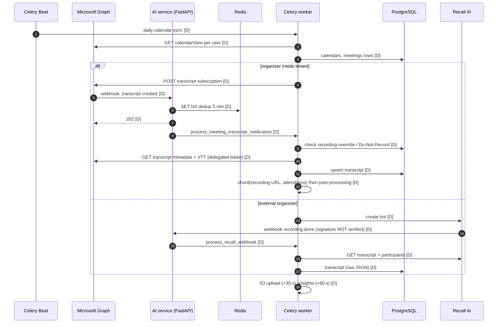

# 04. Integrations and data flows (as documented)

All findings are **DOCUMENTED ONLY** unless marked otherwise. Source labels are the documents' own. Every integration below lives in the Python AI service. The documentation says the .NET API calls no external services [P3-020], and the frontend uses Microsoft Entra ID (MSAL) only, and that path is disabled [P3-034].

## 1. Summary
| Integration | Entry point | Authentication | Data flow | Persistence | Error handling / retries | Sync mechanism | Ledger |
|---|---|---|---|---|---|---|---|
| **Microsoft Graph (Teams)** | Webhooks: meeting-transcripts, user-events, meet-now; Beat daily syncs | App-only (client credentials) and delegated OAuth with refresh | Calendar → meetings → transcript subscription → webhook → fetch metadata and VTT → transcript row → chord (recording URL, attendance) → insights | `calendars`, `meetings`, `transcripts`, `meeting_attendance`, `ms_subscriptions`, `tokens` | Redis de-duplication (5-minute key); returns failed/skipped status; dedup fails open if Redis is lost; Graph `clientState` not validated | Push (webhooks) plus daily pull; subscription renewal every 6 hours | P3-050, P3-051, P3-037 |
| **Recall AI** | `POST /recall-ai/webhooks/status`; on-demand endpoint; calendar sync | API key | Create bot → bot joins → `recording.done` webhook → fetch transcript and participants → same insight pipeline | `recall_ai_bots`, `transcripts` (`transcript_raw_json`) | De-duplication on webhook-id (15 minutes); **signature check commented out** | Push | P3-052, P3-036 |
| **Jira / JSM** | Webhook `jsm-ticket-events`; Beat daily syncs | Basic auth (username and password) | Accounts, customers, projects, licenses (daily); tickets: webhook → 10-second debounce → fetch → upsert → LLM ticket sentiment | `jira_accounts`, `customers`, `projects`, `licenses`, `jsm_tickets` (+ comments, sentiments) | No webhook signature; soft-delete reconciliation task | Push (tickets) plus daily or incremental pull; **no write-back to Jira documented** | P3-053, P3-037 |
| **Tempo** | Beat (every 15 and 20 minutes); manual endpoints | API token | Incremental worklogs plus deletion reconciliation plus backfill | `work_logs` | Not described | Pull | P3-054 |
| **AWS S3** | Post-processing task | Access key | Recording upload (multipart, 30 s after transcript), presigned playback URL, delete on purge, SharePoint→S3 migration | `s3_storage` | Retry-upload endpoint exists | — | P3-055 |
| **LLM (LiteLLM)** | Seven insight tasks; ticket sentiment; cross-entity insights | API key in environment (provider UNKNOWN) | Prompt in, text or JSON out | Insight tables; `llm_runs` (**conflicting accounts**) | **No retry** on insight tasks | — | P3-060, P3-063, P3-064 |
| **Email / Teams chat (Graph)** | After insights; Beat every 5 minutes | Graph | Insight-completed email; pre-meeting chat notices | `ms_meeting_chat_notices` | Not described | Push | P3-071, P3-081 |
| **SigNoz** | OTel agent sidecar | — | Traces, metrics, logs | External | — | — | P3-010 |

## 2. Meeting capture data flow

*Source: `diagrams/04-meeting-capture-sequence.mmd`.*

## 3. Reliability assessment (from the documents)
| Issue | Severity (source) | Ledger |
|---|---|---|
| Unsigned or unchecked webhooks: Recall, Jira, Graph `clientState` | Medium–High | P3-036, P3-037 |
| De-duplication fails open on Redis loss (double processing) | Low–Medium | P3-051 |
| Chord callback can be skipped when a header task fails | Medium (inferred) | P3-018 |
| 14 tasks route to an unconsumed `default` queue when dispatched ad hoc | Depends on production queues | P3-017 |
| No retry on LLM insight tasks; gap until the daily sweep | Medium | P3-064 |
| Jira Basic auth (username/password), not OAuth or tokens | Security hygiene | P3-053 |
| No integration tests across the webhook→task→LLM→storage chain | High (strategy) | P3-090 |

## 4. Not documented anywhere
- Write-back to Jira (creating issues from action items, updating tickets) **[UNKNOWN, no document describes it]**
- Use of Tempo data in health or risk calculation **[UNKNOWN]**
- How a meeting is linked to a project (`meetings.parent_id`): by calendar matching, by Jira contract, or manually **[UNKNOWN]**. The .NET meeting table has `jira_contract_id` [P3-041].
