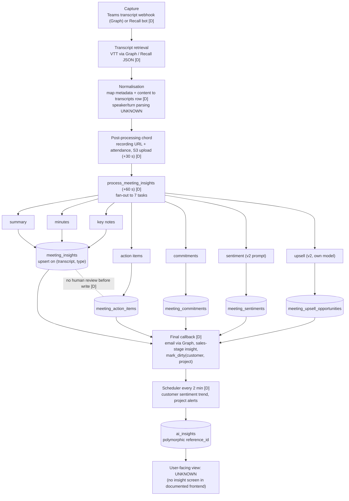

# 05. AI and meeting intelligence pipeline (as documented)

All findings are **DOCUMENTED ONLY** or **UNKNOWN**. The beginner review gives the most code-specific account, with file paths and line numbers at commit `864b477`. Where documents conflict, all versions are shown.

## 1. Pipeline end to end

*Source: `diagrams/05-ai-pipeline.mmd`.*

## 2. Stage by stage
| Stage | What the documents say | Status | Ledger |
|---|---|---|---|
| LLM provider | LiteLLM; model from `LLM_MODEL`, upsell from `UPSELL_LLM_MODEL`; temperature dropped for gpt-5/o1/o3/o4; **production model UNKNOWN** | DOCUMENTED ONLY | P3-060 |
| Sync or async call | Handbook says `acompletion`; the beginner review and strategy say synchronous `completion()` and correct the handbook | DOCUMENTED (majority: sync) | P3-062 |
| Prompts | Jinja2 `system.md.jinja` and `user.md.jinja` per type; 11 template sets, with v2–v4 variants for sentiment and upsell; system prompt rendered without context; transcript inserted verbatim (`autoescape=False`) | DOCUMENTED ONLY | P3-061, P3-038 |
| Summary | One paragraph, 3–6 sentences, ~80–120 words (prompt quoted in the beginner review) | DOCUMENTED ONLY | P3-061 |
| Minutes, key notes | Structured minutes; bullet takeaways | DOCUMENTED ONLY | P3-061 |
| Action items | "Structured action items with owners" stored in `meeting_action_items` | DOCUMENTED ONLY; lifecycle **UNKNOWN** | P3-068 |
| Commitments | "Promises made with deadlines" stored in `meeting_commitments` | DOCUMENTED ONLY | P3-061 |
| Sentiment | Per-meeting scores (v2 prompt); a −100/+100 scale is claimed only by the strategy document | DOCUMENTED / **UNKNOWN scale** | P3-070 |
| Upsell | Separate model; purge, regenerate and domain-exclusion lifecycle (16 test files) | DOCUMENTED ONLY | P3-061 |
| Sales stage | Per-transcript funnel stage per category | DOCUMENTED ONLY | P3-071 |
| JSM ticket sentiment | After each ticket sync; v2–v4 prompts | DOCUMENTED ONLY | P3-053 |
| Cross-entity insights | Dirty-flag jobs; scheduler claims up to 50 every 2 minutes, with a 180 s debounce; reaper; daily coverage sweep; retries counted on the job row | DOCUMENTED ONLY | P3-066 |
| Project and customer context | Prompts receive meeting subject, date, organiser, attendees and the full transcript. **No project history, prior meetings, Jira or Tempo data is documented as prompt context** for per-meeting insights. Cross-entity prompts aggregate sentiment and ticket data | DOCUMENTED ONLY | P3-061, P3-066 |
| Output validation | No structured-output schema enforcement; parsing failures may be silent | DOCUMENTED ONLY | P3-065 |
| Persistence and tracking | Direct upsert or insert. LLM run and token tracking **conflicts** between documents | **UNKNOWN** | P3-063 |
| Retries | None on the seven insight tasks | DOCUMENTED ONLY | P3-064 |
| Human approval | **None before persistence in any document** | DOCUMENTED ONLY | P3-067 |
| RAG / agents / tools / evaluations | None | DOCUMENTED ONLY | P3-065 |

## 3. Assessment (verified problems vs recommendations)
**Problems reported by the documents (verified there, not by me):**
- AI output becomes stored data with no review, validation or confidence score [P3-065, P3-067].
- Regeneration overwrites summary, minutes and key notes without history [P3-046].
- Failures are terminal for that insight until the daily sweep [P3-064].
- Cost per meeting may be untraceable [P3-063].
- Transcripts can inject instructions into prompts [P3-038].

**Structural observations (INFERRED by me):**
- **Seven independent LLM calls per meeting each re-send the full transcript.** No document mentions batching, caching or a combined extraction. Each output is extracted separately, so action items and commitments are produced by different prompts and can overlap or contradict.
- **Action items and commitments are leaves of the transcript.** They have:
  - no documented link to Elevate users (owner appears to be extracted text)
  - no due-date status and no completion
  - no Jira issue link
  - cascade deletion when the transcript is purged
- **They behave as meeting notes, not as delivery records.** Whether the code goes further is UNKNOWN [P3-068].
- **Insights attach to the transcript → meeting → project chain,** which is project-level context. Rocketlane's is account-level (Phase 1 D1-033).
