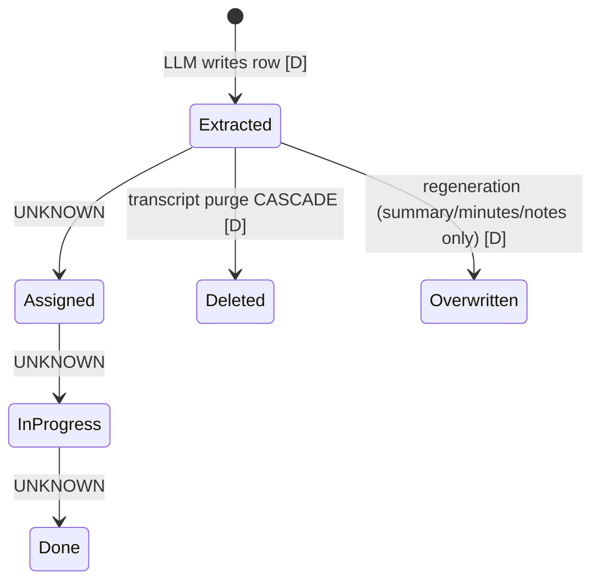

# 06. Business workflows and lifecycle (as documented)

You asked me not to assume a feature exists because a document mentions it. This report therefore separates three cases:
- **workflow traced:** a document describes the steps, routes, tasks and tables
- **entity only:** a table or model exists, but no lifecycle is described
- **claim only:** the feature is asserted with no mechanism given

None is verified in code.

| Workflow | Documentation status | Grade | Ledger |
|---|---|---|---|
| Scheduled Teams meeting → transcript → insights → email → cross-entity refresh | Workflow traced (handbook §11.1, beginner review ch.2) | DOCUMENTED ONLY | P3-042, P3-061, P3-066, P3-071 |
| External meeting via Recall bot | Workflow traced | DOCUMENTED ONLY | P3-052 |
| On-demand recording | Workflow traced (lock, validation, synchronous bot create) | DOCUMENTED ONLY | P3-080 |
| Recording control: stop/start per occurrence or series, Do-Not-Record | Workflow traced; most-tested area | DOCUMENTED ONLY | P3-080 |
| JSM ticket sync → ticket sentiment | Workflow traced | DOCUMENTED ONLY | P3-053 |
| Transcript purge (S3, alerts, cascade, re-flag) | Workflow traced | DOCUMENTED ONLY | P3-042 |
| Customer and project health | Health is a Jira-sourced string on project (`project_health`) and customer (`customer_sentiment`); LLM "customer sentiment trend" in `ai_insights`. **How a health status is computed or updated is not documented** | DOCUMENTED (fields) / UNKNOWN (logic) | P3-047, P3-066 |
| Delivery risks and alerts | LLM "project alerts" aggregate; `alerts` table exists; purge deletes alerts. **No creation rules, assignment, dismissal or resolution described** | Entity only | P3-069 |
| "Needs Attention" | Frontend client-side rules over project and customer lists; separate `NeedsAttention` and `NeedsAttentionComment` models in the AI service, unconnected | Two partial versions | P3-083 |
| Action-item assignment, due dates, overdue, comments, completion | **No document describes any of it.** Only the extraction and storage step | Entity only | P3-068 |
| Commitment tracking | Extraction and storage only | Entity only | P3-061 |
| Risk resolution and dismissal | Not described | UNKNOWN | P3-069 |
| Teams bot (conversational) | Claimed only by the strategy document; code-level documents show only pre-meeting chat notices | Claim only | P3-081 |
| Management dashboards and reporting | Frontend dashboard is a placeholder; no reporting endpoints documented | DOCUMENTED (absent in documented UI) | P3-084 |
| RBAC administration | Workflow traced in the frontend and .NET API; **not enforced** | DOCUMENTED ONLY | P3-035 |
| Employee billing fields (CTC, rate, target hours) | Workflow traced (edit four fields) | DOCUMENTED ONLY | — |

## Lifecycles that are documented

### Recording override
- The override row holds a state: `STATE_DISABLED` or `STATE_ENABLED`.
- A reconcile sweep runs every 5 minutes and applies the state to Graph's transcription setting, or cancels or re-creates the Recall bot.
- An override-cleanup job runs daily.
- *(Handbook §5.3, §11.4; beginner review day 7.)*

### AI insight job
- An entity is marked dirty, the scheduler claims it after a 180 s debounce, and the generate task runs.
- Failures are counted on the job row.
- A reaper clears stuck jobs.
- A daily coverage sweep catches anything missed [P3-066].

### JSM ticket
- A webhook arrives and is debounced for 10 seconds; the ticket is fetched and upserted.
- Ticket sentiment then runs.
- Deletes are soft deletes with reconciliation [P3-053].

## Lifecycles that are missing from all documentation
These are the core of your Phase 4 brief:
1. **Action item:** created → assigned to a person → due → overdue → commented → completed or cancelled. Only the "created by LLM" step is documented.
2. **Commitment:** made → tracked → fulfilled or broken.
3. **Risk / alert:** raised → triaged → mitigated, resolved or dismissed, with an audit trail.
4. **Health:** inputs → score → status change → notification.

*Source: `diagrams/06-action-item-lifecycle.mmd`. Only the transitions marked [D] are documented.*
