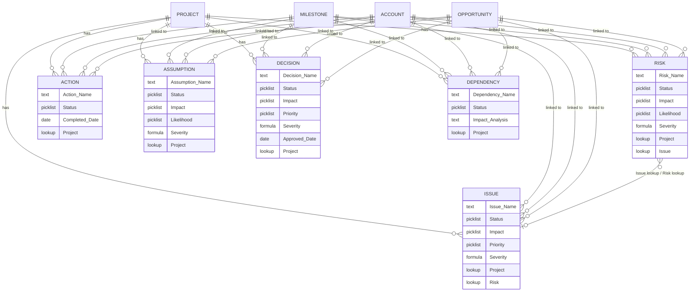
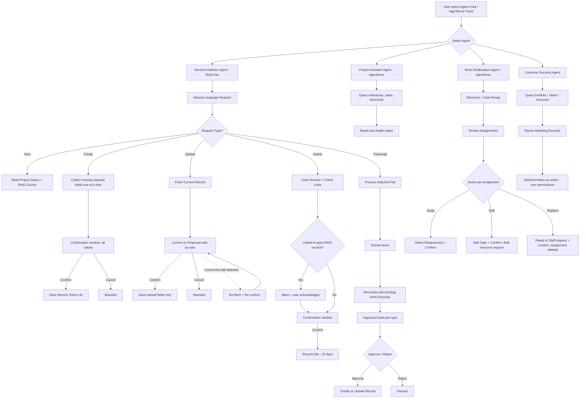
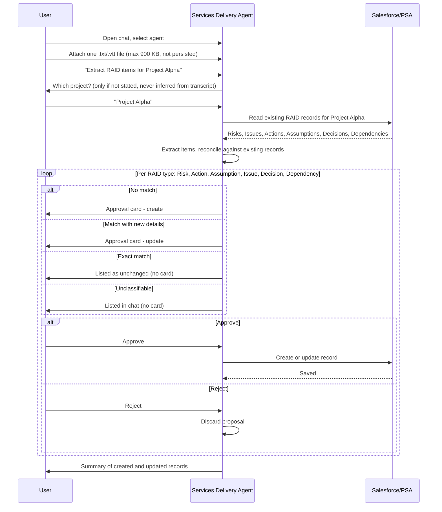
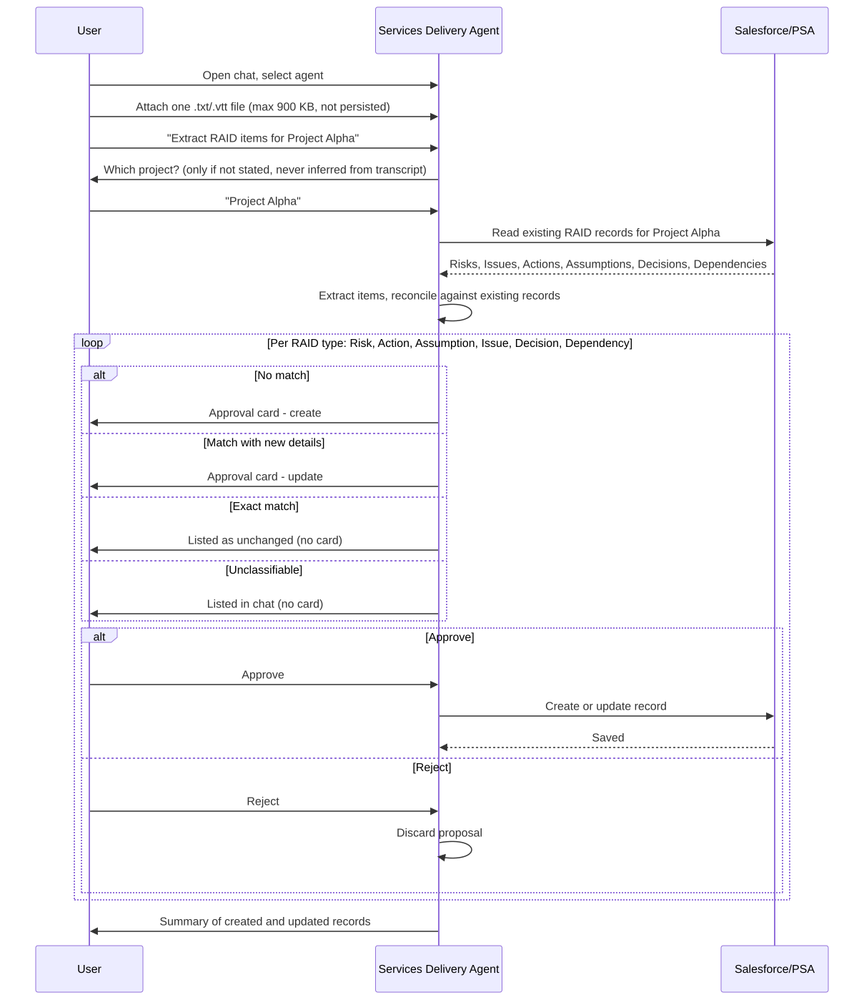

# Reference: Certinia RAID Data Model and Veda AI Agents

> **Scope:** Public documentation only (help.certinia.com, one press article).
> **Versions consulted:** 2023.2, 2024.1, 2025.1, 2025.3, 2026.2, 2026.3. Field pages differ by version; each claim cites the exact page read.
> **Date compiled:** 2026-11-01.
> **Citations:** `[E#]` refers to the Evidence Ledger (section 9). Rows marked *inferred* have no verbatim quote.

---

## 1. RAID Data Model

### 1.1 Object Overview

Certinia PSA tracks six RAID object types [E2], surfaced together in the **RAID Tracker** Lightning component on the Project Plan tab of a Project record [E1].

| Object | API prefix | Required field | Severity formula | Status picklist values |
|---|---|---|---|---|
| **Risk** | `pse__` [E42] | Risk Name [E3] | Impact × Likelihood [E5] | Open, Closed [E4] |
| **Issue** | `pse__` [E42] | Issue Name [E3] | Impact × Priority [E7] | Not Yet Started, In Progress, Completed, On Hold, Closed - No action [E6] |
| **Action** | `pse__` (*inferred*: same managed package) | Action Name [E3] | — (none documented) | Not Started, In Progress, Completed [E9] |
| **Assumption** | `pse__` (*inferred*) | Assumption Name [E3] | "Calculated from impact and likelihood values" (formula not stated) | Active, Validated, Invalidated [E10] |
| **Decision** | `pse__` (*inferred*) | Decision Name [E3] | Impact × Priority [E40] | Proposed, Approved, Rejected ("include") [E39] |
| **Dependency** | `pse__` (*inferred*) | Dependency Name [E3] | — (none documented) | Open, Closed ("include") [E11] |

`pse__` is evidenced only by API names on the RAID Tracker Fields page (e.g. `pse__Risk_Name__c`, `pse__Status__c`, `pse__Severity__c`) [E42]. API names for Action, Assumption, Decision and Dependency fields are not published.

### 1.2 Risk Fields
Source: https://help.certinia.com/main/2024.1/Content/PSA/Features/Risks/RiskFields.htm

| Field | Required | Type (inferred from description) | Values | Relationship |
|---|---|---|---|---|
| Risk Name | **Yes** | Text | — | — |
| Risk Description | No | Long text | — | — |
| Risk Owner | No | Lookup | — | Resource (Contact) |
| ID | No | Unique reference (auto) | — | — |
| Date Raised | No | Date | — | — |
| Closed Date | No | Date | — | — |
| Status | No | Picklist | Open, Closed | — |
| Closed | No | Checkbox (derived) | Page text says true when Status is "Completed or Closed - No action" — values that do not exist on Risk; copy error [E46] | — |
| Impact | No | Picklist | 1–5 | — |
| Likelihood | No | Picklist | 1–5 | — |
| Severity | Formula | Number | Impact × Likelihood | — |
| Mitigation Plan | No | Long text | — | — |
| Contingency | No | Long text | — | — |
| Comments | No | Long text | — | — |
| Project | No | Lookup | — | Project |
| Milestone | No | Lookup | — | Milestone |
| Account | No | Lookup | — | Account |
| Opportunity | No | Lookup | — | Opportunity |
| Project Task | No | Lookup | — | Project Task |
| Issue | No | Lookup | — | Issue |

### 1.3 Issue Fields
Source: https://help.certinia.com/main/2024.1/Content/PSA/Features/Issues/IssueFields.htm

| Field | Required | Type (inferred) | Values | Relationship |
|---|---|---|---|---|
| Issue Name | **Yes** | Text | — | — |
| Issue Description | No | Long text | — | — |
| Issue Owner | No | Lookup | — | Resource |
| Issue Number | No | Unique reference | — | — |
| Date Raised | No | Date | — | — |
| Closed Date | No | Date | — | — |
| Status | No | Picklist | Not Yet Started, In Progress, Completed, On Hold, Closed - No action | — |
| Closed | No | Checkbox (derived) | True when Status is Completed or Closed - No action | — |
| Impact | No | Picklist | 1–5 | — |
| Priority | No | Picklist | 1–5 | — |
| Severity | Formula | Number | Impact × Priority | — |
| Action Plan | No | Long text | — | — |
| Comments | No | Long text | — | — |
| Project / Milestone / Account / Opportunity / Project Task | No | Lookup | — | respective object |
| Risk | No | Lookup | — | Risk |

### 1.4 Action Fields
Source: https://help.certinia.com/main/2025.3/Content/PSA/Features/Actions/ActionFields.htm

| Field | Required | Type (inferred) | Values | Relationship |
|---|---|---|---|---|
| Action Name | **Yes** | Text | — | — |
| Action Description | No | Long text | — | — |
| Action Owner | No | Lookup | — | Resource |
| Date Raised | No | Date | — | — |
| Status | No | Picklist | Not Started, In Progress, Completed | — |
| Completed | No | Checkbox (derived) | — | — |
| Completed Date | No | Date | — | — |
| Comments | No | Long text | — | — |
| Project / Milestone / Account / Opportunity / Project Task | No | Lookup | — | respective object |

No Impact, Priority, Likelihood or Severity fields are listed for Action.

### 1.5 Assumption Fields
Source: https://help.certinia.com/main/2025.3/Content/PSA/Features/Assumptions/AssumptionFields.htm

| Field | Required | Type (inferred) | Values | Relationship |
|---|---|---|---|---|
| Assumption Name | **Yes** | Text | — | — |
| Assumption Description | No | Long text | — | — |
| Assumption Owner | No | Lookup | — | Resource |
| Date Raised | No | Date | — | — |
| Status | No | Picklist | Active, Validated, Invalidated (default Active per create page) | — |
| Impact | No | Picklist | 1–5 | — |
| Likelihood | No | Picklist | 1–5 | — |
| Severity | Calculated | Number | "Calculated from impact and likelihood values" | — |
| Validated | No | Checkbox (derived from status) | — | — |
| Validated Date | No | Date | — | — |
| Validation Plan | No | Long text | — | — |
| Comments | No | Long text | — | — |
| Project / Milestone / Account / Opportunity / Project Task | No | Lookup | — | respective object |

### 1.6 Decision Fields
Source: https://help.certinia.com/main/2025.3/Content/PSA/Features/Decision/DecisionFields.htm (note folder is `Decision`, singular)

| Field | Required | Type (inferred) | Values | Relationship |
|---|---|---|---|---|
| Decision Name | **Yes** | Text | — | — |
| Decision Description | No | Long text | — | — |
| Decision Owner | No | Lookup | — | Resource |
| Date Raised | No | Date | — | — |
| Status | No | Picklist | Proposed, Approved, Rejected ("include") | — |
| Approved | No | Checkbox (derived) | True when status is Approved, false otherwise | — |
| Approved Date | No | Date | — | — |
| Impact | No | Picklist | 1–5 | — |
| Priority | No | Picklist | 1–5 | — |
| Severity | Calculated | Number | Impact × Priority | — |
| Comments | No | Long text | — | — |
| Account | No | Lookup | Description reads "related to dependency" — copy error | Account |
| Project / Milestone / Opportunity / Project Task | No | Lookup | — | respective object |

Decisions are "tracked by Approval Dates" rather than closed dates [E41]. The RAID Tracker grid still shows a "Date Closed" column for Decisions; which Decision field feeds it is not documented.

### 1.7 Dependency Fields
Source: https://help.certinia.com/main/2025.3/Content/PSA/Features/Dependencies/DependencyFields.htm

| Field | Required | Type (inferred) | Values | Relationship |
|---|---|---|---|---|
| Dependency Name | **Yes** | Text | — | — |
| Dependency Description | No | Long text | — | — |
| Dependency Owner | No | Lookup | — | Resource |
| Date Raised | No | Date | — | — |
| Closed Date | No | Date | — | — |
| Status | No | Picklist | Open, Closed ("include") | — |
| Closed | No | Checkbox (derived) | True when closed, false when open | — |
| Impact Analysis | No | Long text | — | — |
| Comments | No | Long text | — | — |
| Project / Milestone / Account / Opportunity / Project Task | No | Lookup | — | respective object |

### 1.8 Cross-Object Relationships

Every RAID object has optional lookups to **Project, Milestone, Account, Opportunity, Project Task**, plus an **Owner** lookup to a Resource (sections 1.2–1.7).

The only documented inter-RAID relationship is **Risk ↔ Issue** [E8]: Risk has an Issue lookup, Issue has a Risk lookup, and selecting either in the RAID Tracker shows its counterpart in the Record Details panel. No lookup links Action, Assumption, Decision or Dependency to other RAID records. The agent's delete flow nonetheless checks for "dependency links" to other open RAID records [E23]; what defines such a link is not documented.

The RAID **Dependency** object is separate from **Project Task Dependency** records (task-to-task predecessor links such as Finish to Start).

### 1.9 Lifecycle and Alerts

| Object | Lifecycle (from status values) | Terminal-state marker |
|---|---|---|
| Risk | Open → Closed | Closed checkbox, Closed Date |
| Issue | Not Yet Started → In Progress → Completed / On Hold / Closed - No action | Closed checkbox (Completed or Closed - No action), Closed Date |
| Action | Not Started → In Progress → Completed | Completed checkbox, Completed Date |
| Assumption | Active → Validated / Invalidated | Validated checkbox, Validated Date |
| Decision | Proposed → Approved / Rejected | Approved checkbox, Approved Date |
| Dependency | Open → Closed | Closed checkbox, Closed Date |

Arrows show the plausible order; Certinia documents only the picklist values, not allowed transitions.

**Alerts:** "Alerts are sent to project managers" [E44], configured through Salesforce Workflow and Approval Processes [E45]. Certinia ships no documented alert rules; triggers are left to the admin. The RAID grid reloads automatically when a RAID record changes while in view mode [E43].

### 1.10 RAID Tracker Grid Columns by View
Source: https://help.certinia.com/main/2025.3/Content/PSA/Features/RAIDTracker/RAIDTrackerUsing.htm

| View | Columns |
|---|---|
| **RAID** (default) | RAID Type, Name, Owner, Date Raised, Likelihood, Impact, Priority, Severity, Status, Milestone, Date Closed |
| **Risks** | Name, Owner, Date Raised, Likelihood, Impact, Severity, Status, Milestone, Date Closed |
| **Issues** | Name, Owner, Date Raised, Likelihood, Impact, Severity, Status, Milestone, Date Closed |
| **Actions** | Name, Owner, Date Raised, Status, Milestone, Date Closed |
| **Assumptions** | Name, Owner, Date Raised, Likelihood, Impact, Severity, Status, Milestone, Date Closed |
| **Decisions** | Name, Owner, Date Raised, Impact, Priority, Status, Milestone, Date Closed |
| **Dependencies** | Name, Owner, Date Raised, Status, Milestone, Date Closed |

- Up to 100 records per view [E35]; last-modified record shown first.
- Inline editing in every view except the combined RAID view.
- Filter panel has one field: Status.
- Record Details panel shows Name, Date Raised, Owner, Description, unless a per-object custom field set is configured.

### 1.11 Permissions
Source: https://help.certinia.com/main/2025.3/Content/PSA/Features/RAIDTracker/RAIDTrackerPermissions.htm

- **Permission set:** PSA - Manage Projects [E12]
- **Apex class access:** RAID_ActionController, RAID_AssumptionController, RAID_DecisionController, RAID_DependencyController, RAID_IssueController, RAID_RiskController, TelemetryLoggerController. (The page shows "Enabled" only on the first row.)
- **Field sets:** Risk / Action / Assumption / Issue / Decision / Dependency Custom Fields Field Set, each default None.

---

## 2. RAID Object Relationship Diagram

Project Task and Owner (Resource) lookups exist on all six objects but are left out of the diagram for readability.

---

## 3. Veda AI Platform

### 3.1 Deployment Modes

Veda offers "two deployment options" [E14].

| Mode | What the docs state | Permission model |
|---|---|---|
| **Veda Flex** | Certinia-native [E36]. Agents live in the **AI Connector** package and run in "the shared chat container that hosts the Veda Flex agents" [E52], opened from the Veda global action in the Salesforce header. Agent choice is locked for each chat. When opened from a record page, the chat automatically includes that record's context [E55]. | Agent visibility depends on "custom permissions your administrator has granted you" [E53]. Writes need the user's own object permissions [E34]. Every response is recorded in the chat session for auditing [E54]. Agent Chat also lists "Tool Execution Records" and "Agent Cards" topics; those pages were not read. |
| **Veda for Agentforce** | Salesforce-native [E37]. Agents open from the Agentforce panel. The Work Reallocation agent "uses a Salesforce Employee agent" [E57]. | Per-agent Apex class access plus object and field permissions (e.g. Project Assistant [E63], Work Reallocation [E58], [E59]). Setup steps (Einstein Agent license, agent from template, permission sets) come from a search snippet of the CS Agent setup page, which was not read [E64]. |
| **Headless MCP** | **Not mentioned** on any page read. | **UNKNOWN** |

### 3.2 Agent and AI Feature Catalogue

Availability is recorded only where a page states it.

#### PSA

| # | Name | Type | Deployment (as stated) | Availability (as stated) |
|---|---|---|---|---|
| 1 | Certinia Services Delivery Agent | Conversational agent | Veda Flex [E13] | Early Adopter Program [E32] |
| 2 | Certinia Project Assistant Agent | Conversational agent | Veda for Agentforce [E56] | Not stated on pages read |
| 3 | Certinia Work Reallocation Agent | Conversational agent | Veda for Agentforce [E57] | Not stated on pages read |
| 4 | Project AI Summary | Generative AI component | — | Early Adopter Program (summary pages note) |
| 5 | Project Task AI Summary | Generative AI | — | Not read |
| 6 | PSA Resource AI Summary | Generative AI | — | Not read |
| 7 | Skill and Certification Extraction | Generative AI | Requires AI Core package for AI extraction | Not stated |

#### Customer Success Cloud

| # | Name | Type | Deployment (as stated) | Availability (as stated) |
|---|---|---|---|---|
| 8 | Certinia Customer Success Agent | Conversational agent | Listed as "Veda for Agentforce Conversational Agent" in the CSC AI features table [E51]. Also documented under the AI Connector path and opened from the Veda global action [E33], so it may ship in both modes (*inferred*). | Early Adopter Program (query page note) |
| 9–18 | Account Summary, Success Management Summary, CS Activity Summary, Executive Briefing, Business Review Summary, Playbook Closing Summary, Dynamic Playbooks, Objective AI Generation, Objective KPI AI Generation, Success Plan AI Generation | Generative AI | — | Not stated |

### 3.3 Agent Trigger → Context → Action → Human Gate

| Agent | Trigger | Context read | Create / Update / Delete | Human gate |
|---|---|---|---|---|
| **Services Delivery Agent** | User message in agent chat | Project, all six RAID objects, project status fields, attached transcript (not persisted) [E16] | **C/U/D** on all six RAID objects; **U** on 5 project status fields [E28] | Create: confirmation window with all values [E21]. Update: side-by-side current and proposed values, only named fields change, re-confirm on concurrent edit [E22]. Delete: link check and warning, then confirm; goes to Recycle Bin for 15 days [E23], [E24]. Transcript: per-card Approve/Reject [E18]. |
| **Project Assistant Agent** | User message in Agentforce panel | Milestones, timecards, project tasks, assignments, schedules | **None.** Object permissions table grants Read only, no Create (*inferred from table* [E63]) | None needed (read-only) |
| **Work Reallocation Agent** | User message in Agentforce panel | Assignments, resources, availability, billable status | **C** resource request (draft on split [E27]; "Ready to Staff" on replace). **U** assignment End Date / Scheduled Hours. **D** assignment on replace. Requires Resource Request Entry permission control [E58]. | Confirm at each swap, split, new request and hold |
| **Customer Success Agent** | User message in agent chat | Accounts, success plans, objectives, playbooks, playbook tasks | Query page: "analyzes existing records only" [E33]; follow-up create/update need the user's own permissions [E34]. CSC table: creates and manages playbooks and playbook tasks. | Disambiguation list when several records match. Write confirmation steps **not documented**. |
| **Project AI Summary** | User clicks Generate Summary, then Generate RAID Next Steps | Financials, risks, staffing, deliverables, RAID items | **C** Action / Issue / Risk via buttons [E25], [E50] | User clicks Create, enters details, saves [E49]. No auto-creation. |
| **Skill and Certification Extraction** | User action in Manage Skills and Certifications window [E60] | Comma-separated list, free text, or a PDF/TXT document | **U** resource profile skills and certifications | User adds the matched items from the window (selection step *inferred*) |

### 3.4 Services Delivery Agent: Transcript-to-RAID Workflow
Sources: AttachingTranscript.htm and ExtractingRAIDItemsFromATranscript.htm (full URLs in ledger)

1. Open agent chat and select the Services Delivery agent.
2. Click attach and pick **one .txt or .vtt file** [E38], max 900 KB [E17]. It shows as a pill in the chat. It is **not saved to Salesforce** [E16].
3. State the intent and the project. A file sent without instructions is not processed.
4. If the project is missing, the agent asks. It **never infers the project from transcript content** [E19].
5. The agent reads the project's existing RAID records, extracts items, and reconciles:
   - match with new details → **propose update** [E20]
   - no match → **propose new record** [E48]
   - exact match, nothing new → no card; listed as unchanged
   - cannot classify → listed in chat, not proposed
   - owner not resolvable to a single Contact → proposed with **no owner** [E47]
6. **Approval cards** appear one at a time per RAID type, in order risk, action, assumption, issue, decision, dependency. Each type can have a create card and an update card.
7. User clicks **Approve** or **Reject** per card [E18].
8. Agent reports what was created and updated.

**Answers to the study questions:**
- Transcripts are **attached manually** by the user [E15]. No automatic ingestion is documented.
- Extraction **never writes directly**. Every create or update waits on an approval card. The docs never use the word "draft"; proposals exist only as cards in the chat.
- Dictating a single item while a transcript is attached uses the normal create flow, not extraction.

### 3.5 Project AI Summary: "create action, issue and risk records from the summary"
Source: https://help.certinia.com/main/2025.3/Content/PSA/Features/Projects/GenerativeAI/CertiniaSummary/CertiniaSummaryPSAUsing.htm

1. On the project record, click **Generate Summary**.
2. Click **Generate RAID Next Steps** at the bottom of the summary.
3. Window shows **Overview** (most severe issues and risks, in-progress actions, relevant assumptions, decisions and dependencies, with links) and **Next Steps**, which "provides up to five recommended actions" [E26].
4. Next to a recommendation, click **Create Action**, **Create Issue**, or **Create Risk** [E25].
5. Enter details, then save [E49]. The user needs create permission on all three objects.

Which fields are pre-filled from the recommendation is not documented.

### 3.6 Work Reallocation Agent
Source: https://help.certinia.com/main/2026.2/Content/PSA_AI_Agents/Features/CertiniaWorkReallocationAgent/ReallocatingAssignments.htm

1. Open the Agentforce panel and give a resource plus date range, optionally filtered to billable or non-billable work.
2. Agent lists matching resources in groups of five. User picks one.
3. For each assignment:
   - **Swap:** use the suggested resource, name one, or review up to three alternatives, then confirm.
   - **Split:** enter a split date after the latest expense or timecard. Creates a **draft resource request** [E27].
   - **Replace:** creates a "Ready to Staff" resource request and deletes the assignment. A resource can be held.
4. User confirms each change. Planning and execution run through `pse.AssignmentReallocationPlanAction` and `pse.PlanExecutionAction` ("executes a smart action plan") [E59].

---

## 4. Veda Agent Workflow Diagram

---

## 5. Transcript-to-RAID Flow Diagram

---

## 6. Moonnox

### Known (single verified source: diginomica, 21 July 2026)
Source: https://diginomica.com/certinia-acquires-moonnox-speed-progress-ai-native-psa

- Certinia is buying Moonnox, an AI-automation startup [E30]. Chicago-based, founded 2022 by three Bluewolf alumni, $2M seed round.
- Moonnox works from context extracted from unstructured content (call transcripts, SOWs, project plans, design documents are named as examples of where the IP lives).
- The deal is framed as extending "its recently launched Veda AI agent platform" [E31].
- Moonnox tracks token cost [E61]. Certinia plans to factor AI token spend into project margins.
- Cited customer result: Spaulding Ridge cut solution-architecture drafting from 80 hours to 20 [E62].
- Secondary outlets (search snippets only, not verified) report that the Moonnox brand is being retired [E65].

### How captured context reaches PSA records: UNKNOWN

| Aspect | Status |
|---|---|
| Capture mechanism (connector, API, file upload) | **UNKNOWN** |
| Which PSA records are created or updated | **UNKNOWN** |
| Whether it feeds the Services Delivery Agent transcript flow | **UNKNOWN** |
| Integration architecture (MCP, REST, Salesforce Connect) | **UNKNOWN** |
| Human approval requirements | **UNKNOWN** |
| Availability timeline and pricing | **UNKNOWN** |

help.certinia.com contains no Moonnox page.

---

## 7. Design Recommendations

For anyone building a RAID tracker with agents. Each item is labeled **Observed pattern** (Certinia does this) or **Our design choice** (goes beyond or departs from Certinia).

1. **Per-item approval cards for bulk extraction.** *Observed pattern* [E18]. Show one card per RAID type with separate create and update cards, each approved or rejected on its own. Never apply a whole extraction batch on one click. *Our design choice:* add "approve all of this type" only after the user has seen each item.

2. **Require explicit scope; never infer the target from unstructured content.** *Observed pattern* [E19]. Ask for the project even when the transcript names one. This prevents writing to the wrong project from a misheard or ambiguous name.

3. **Reconcile before create.** *Observed pattern* [E20], [E48]. Read existing records first. Classify each extracted item as update, create or no-op, and list the no-ops so the user knows why no card appeared. This avoids duplicate RAID rows, the main failure of naive extraction.

4. **Confirmation with full values on create, diff on update, and change only named fields.** *Observed pattern* [E21], [E22]. Show every field value before a create. For updates, show current and proposed values side by side and touch only the fields the user named.

5. **Optimistic concurrency with re-fetch and re-confirm.** *Observed pattern* [E22]. If the record changed while the confirmation was open, reload it and ask again. Do not save over another user's edit.

6. **Soft delete plus link check.** *Observed pattern* [E23], [E24]. Before deleting, warn about links to other open RAID items, then move the record to a recoverable bin. *Our design choice:* make links first-class (gap 10) so the warning rests on real relationships.

7. **Ephemeral source documents, with provenance kept.** *Observed pattern:* the transcript is not persisted and has strict format and size limits [E16], [E17], [E38]. *Our design choice:* still store a hash and timestamp of the source, plus the cited excerpt per created record, so each RAID item can be traced to what was said. Certinia documents no such link.

8. **Leave unresolved fields blank rather than guess.** *Observed pattern* [E47]. Propose the record with no owner when a name maps to several contacts. *Our design choice:* add an "owner unresolved" flag and a follow-up queue so blanks don't persist silently.

9. **Permission parity, per-agent entitlement, and audit.** *Observed pattern:* agents act with the user's own CRUD rights [E34], per-agent access via custom permissions [E53], and every response is recorded for auditing [E54]. *Our design choice:* tie every write to conversation ID, approving user and card ID, and store verbatim notes unchanged ([E29] observed).

10. **Gap — fully model Decision and cross-RAID links.** *Our design choice.* Certinia's Decision object exists (Proposed/Approved/Rejected, Impact × Priority [E39], [E40], [E41]), but its field page has copy errors, and the only inter-RAID link is Risk↔Issue [E8]. Add typed links (Decision resolves Issue, Assumption invalidated becomes Risk, Dependency blocks Action), and give every object a single derived `is_closed` rule. Certinia's Risk "Closed" description cites statuses Risk does not have [E46].

11. **Gap — built-in alerting.** *Our design choice.* Certinia sends alerts to PMs only through admin-built Workflow and Approval Processes [E44], [E45]. Ship default rules: severity at or above a threshold, item overdue against Milestone date, Assumption past Validated Date, Dependency open past milestone, routed to project manager and owner, with digest controls.

12. **Gap — automatic transcript ingestion, still gated.** *Our design choice.* Certinia requires a manual upload per conversation [E15], [E38]. Ingest meeting transcripts from calendar or recording connectors into a per-project review queue, tag the project by meeting-to-project mapping (not by text inference, per item 2), and keep the item 1 and 3 gates. Nothing is written without per-card approval.

---

## 8. UNKNOWN List

### RAID data model
1. API names for Action, Assumption, Decision and Dependency fields (only Risk/Issue grid fields are published).
2. Field data types. No field page states types; all types here are inferred.
3. Whether Decision and Dependency status picklists have values beyond those listed (pages say "include").
4. Which Decision field feeds the grid's "Date Closed" column (Decision has Approved Date, not Closed Date).
5. Allowed status transitions and any validation rules.
6. Alert trigger conditions. Only "configure via Workflow and Approval Processes" is documented.
7. What counts as a "dependency link" in the agent's delete check, given no inter-RAID lookups exist beyond Risk↔Issue.
8. The Risk "Closed" checkbox rule. The page cites Issue statuses; the real Risk rule is undocumented.

### Veda agents
9. Headless MCP deployment. Not mentioned anywhere read.
10. Veda Flex setup steps and the exact custom-permission names per agent.
11. Veda for Agentforce setup steps (only seen in a search snippet, not read).
12. Agent Cards, Tool Execution Records and Agent Chat Sessions topics. Titles listed, pages not read.
13. Customer Success Agent write confirmations, and whether it ships in both deployment modes.
14. Availability status for the Project Assistant and Work Reallocation agents.
15. Which fields Project AI Summary pre-fills when creating Action/Issue/Risk from a recommendation.
16. Whether any agent runs on a schedule or event. Every documented trigger is a user message or click; Dynamic Playbooks (CSC) is the only flow-triggered feature.
17. Project Task AI Summary and PSA Resource AI Summary detail pages (not read).

### Moonnox
18. Capture mechanism, target PSA records, integration architecture, approval gates, timeline, pricing.
19. Whether the brand-retirement report is accurate (Enterprise Times returned HTTP 403; not verified).

---

## 9. Evidence Ledger

Quotes were checked as verbatim substrings of the page text after stripping HTML tags and collapsing whitespace (checked 2026-11-01). Rows marked *inferred* carry no quote.

| # | Claim | Source URL | Verbatim quote (≤15 words) |
|---|---|---|---|
| E1 | RAID Tracker location | https://help.certinia.com/main/2025.3/Content/PSA/Features/RAIDTracker/RAIDTrackerUsing.htm | "The RAID Tracker is available under the Project Plan tab on the Project Lightning page." |
| E2 | Six RAID object types | https://help.certinia.com/main/2025.3/Content/PSA/Features/RAIDTracker/RAIDTrackerOverview.htm | "Risks, Actions, Assumptions, Issues, Decisions, and Dependencies (RAID) throughout the project lifecycle" |
| E3 | `<Object> Name` is the only mandatory field on each of the six field pages | https://help.certinia.com/main/2024.1/Content/PSA/Features/Risks/RiskFields.htm (and each object's Fields page) | no verbatim quote — *inferred* from the "*" mandatory marker in the table cell beside each Name field |
| E4 | Risk status values | https://help.certinia.com/main/2024.1/Content/PSA/Features/Risks/RiskFields.htm | "The status of the risk. Values are Open and Closed." |
| E5 | Risk severity formula | https://help.certinia.com/main/2024.1/Content/PSA/Features/Risks/RiskFields.htm | "Calculated by multiplying the Impact value by the Likelihood value." |
| E6 | Issue status values | https://help.certinia.com/main/2024.1/Content/PSA/Features/Issues/IssueFields.htm | "Values are Not Yet Started, In Progress, Completed, On Hold, Closed - No action." |
| E7 | Issue severity formula | https://help.certinia.com/main/2024.1/Content/PSA/Features/Issues/IssueFields.htm | "Calculated by multiplying the Impact value by the Priority value." |
| E8 | Risk↔Issue association | https://help.certinia.com/main/2023.2/Content/PSA/Features/Issues/AboutIssues.htm | "You can associate risks with issues and vice versa." |
| E9 | Action status values | https://help.certinia.com/main/2025.3/Content/PSA/Features/Actions/ActionFields.htm | "options include Not Started, In Progress, and Completed" |
| E10 | Assumption status values | https://help.certinia.com/main/2025.3/Content/PSA/Features/Assumptions/AssumptionFields.htm | "Values are Active, Validated, and Invalidated." |
| E11 | Dependency status values | https://help.certinia.com/main/2025.3/Content/PSA/Features/Dependencies/DependencyFields.htm | "Values include Open and Closed." |
| E12 | RAID Tracker permission set | https://help.certinia.com/main/2025.3/Content/PSA/Features/RAIDTracker/RAIDTrackerPermissions.htm | "PSA - Manage Projects" |
| E13 | Services Delivery Agent is Veda Flex | https://help.certinia.com/main/2026.3/Content/AI_Connector_Summer2026/Features/ServicesDeliveryAgent/CertiniaServicesDeliveryAgentOverview.htm | "is a conversational Veda Flex AI agent" |
| E14 | Two deployment options | https://help.certinia.com/main/2026.3/Content/Veda/Veda.htm | "You can access these agents through two deployment options" |
| E15 | Transcript attached by the user | https://help.certinia.com/main/2026.3/Content/AI_Connector_Summer2026/Features/ServicesDeliveryAgent/AttachingTranscript.htm | "enables you attach a transcript directly to your conversation" |
| E16 | Transcript not persisted | https://help.certinia.com/main/2026.3/Content/AI_Connector_Summer2026/Features/ServicesDeliveryAgent/AttachingTranscript.htm | "The attached transcript is not saved to Salesforce." |
| E17 | 900 KB limit | https://help.certinia.com/main/2026.3/Content/AI_Connector_Summer2026/Features/ServicesDeliveryAgent/AttachingTranscript.htm | "Attachments larger than 900 KB are rejected." |
| E18 | Per-card approve/reject | https://help.certinia.com/main/2026.3/Content/AI_Connector_Summer2026/Features/ServicesDeliveryAgent/ExtractingRAIDItemsFromATranscript.htm | "click Approve to apply that card's changes, or Reject to discard them" |
| E19 | Project never inferred | https://help.certinia.com/main/2026.3/Content/AI_Connector_Summer2026/Features/ServicesDeliveryAgent/ExtractingRAIDItemsFromATranscript.htm | "The agent never infers the project from the transcript's content" |
| E20 | Reconcile: update on match | https://help.certinia.com/main/2026.3/Content/AI_Connector_Summer2026/Features/ServicesDeliveryAgent/ExtractingRAIDItemsFromATranscript.htm | "the agent proposes an update to that record" |
| E21 | Create saved only after confirm | https://help.certinia.com/main/2026.3/Content/AI_Connector_Summer2026/Features/ServicesDeliveryAgent/CreatingRAIDItems.htm | "The record is saved only after you confirm" |
| E22 | Concurrent-edit re-fetch | https://help.certinia.com/main/2026.3/Content/AI_Connector_Summer2026/Features/ServicesDeliveryAgent/UpdatingRAIDItems.htm | "the agent detects the conflict, re-fetches the latest values, and asks you to confirm again" |
| E23 | Delete link check | https://help.certinia.com/main/2026.3/Content/AI_Connector_Summer2026/Features/ServicesDeliveryAgent/DeletingRAIDItems.htm | "whether the record is linked to any other open RAID records" |
| E24 | Recycle Bin, 15 days | https://help.certinia.com/main/2026.3/Content/AI_Connector_Summer2026/Features/ServicesDeliveryAgent/DeletingRAIDItems.htm | "is recoverable by an administrator for 15 days" |
| E25 | Create Action button | https://help.certinia.com/main/2025.3/Content/PSA/Features/Projects/GenerativeAI/CertiniaSummary/CertiniaSummaryPSAFieldsAndButtons.htm | "Enables you to create an action record from the RAID Next Steps window." |
| E26 | Up to five next steps | https://help.certinia.com/main/2025.3/Content/PSA/Features/Projects/GenerativeAI/CertiniaSummary/CertiniaSummaryPSAUsing.htm | "provides up to five recommended actions" |
| E27 | Split creates draft resource request | https://help.certinia.com/main/2026.2/Content/PSA_AI_Agents/Features/CertiniaWorkReallocationAgent/ReallocatingAssignments.htm | "draft resource request" |
| E28 | Five updatable status fields | https://help.certinia.com/main/2026.3/Content/AI_Connector_Summer2026/Features/ServicesDeliveryAgent/UpdatingProjectStatus.htm | "Project Status, Scheduled Status, Scope Status, Financial Status, and Project Status Notes" |
| E29 | Notes kept verbatim | https://help.certinia.com/main/2026.3/Content/AI_Connector_Summer2026/Features/ServicesDeliveryAgent/UpdatingProjectStatus.htm | "Status notes are saved exactly as you enter them, without rephrasing." |
| E30 | Moonnox acquisition | https://diginomica.com/certinia-acquires-moonnox-speed-progress-ai-native-psa | "It is buying Moonnox, a startup that specializes in AI automation" |
| E31 | Extends Veda | https://diginomica.com/certinia-acquires-moonnox-speed-progress-ai-native-psa | "extend the capabilities of its recently launched Veda AI agent platform" |
| E32 | SDA availability | https://help.certinia.com/main/2026.3/Content/AI_Connector_Summer2026/Features/ServicesDeliveryAgent/ViewingProjectStatus.htm | "This feature is part of the Certinia Early Adopter Program." |
| E33 | CS Agent query scope | https://help.certinia.com/main/2026.3/Content/AI_Connector_Summer2026/Features/CustomerSuccessAgent/QueryingYourPortfolioAndTaskAssignments.htm | "This feature analyzes existing records only." |
| E34 | Writes need user permissions | https://help.certinia.com/main/2026.3/Content/AI_Connector_Summer2026/Features/CustomerSuccessAgent/QueryingYourPortfolioAndTaskAssignments.htm | "To take follow-up actions, such as creating or updating records" |
| E35 | 100 records per view | https://help.certinia.com/main/2025.3/Content/PSA/Features/RAIDTracker/RAIDTrackerUsing.htm | "The grid will load up to 100 records for each view" |
| E36 | Veda Flex is Certinia-native | https://help.certinia.com/main/2026.3/Content/Veda/Veda.htm | "Veda Flex. This our Certinia-native option." [sic] |
| E37 | Agentforce is Salesforce-native | https://help.certinia.com/main/2026.3/Content/Veda/Veda.htm | "Veda for Agentforce. This is the Salesforce-native option." |
| E38 | One .txt/.vtt file | https://help.certinia.com/main/2026.3/Content/AI_Connector_Summer2026/Features/ServicesDeliveryAgent/AttachingTranscript.htm | "attach only a single transcript file in .txt or .vtt format" |
| E39 | Decision status values | https://help.certinia.com/main/2025.3/Content/PSA/Features/Decision/DecisionFields.htm | "Values include Proposed, Approved, and Rejected." |
| E40 | Decision severity formula | https://help.certinia.com/main/2025.3/Content/PSA/Features/Decision/DecisionFields.htm | "Calculated by multiplying the impact and priority values." |
| E41 | Decisions tracked by approval date | https://help.certinia.com/main/2025.3/Content/PSA/Features/Decision/AboutDecisions.htm | "tracked by Approval Dates to identify when they were finalized" |
| E42 | `pse__` API prefix | https://help.certinia.com/main/2025.3/Content/PSA/Features/RAIDTracker/RAIDTrackerFields.htm | "pse__Risk_Name__c" |
| E43 | Grid auto-reloads | https://help.certinia.com/main/2025.3/Content/PSA/Features/RAIDTracker/RAIDTrackerUsing.htm | "The RAID grid will automatically reload if there are changes to any RAID record" |
| E44 | Alerts to PMs | https://help.certinia.com/main/2023.2/Content/PSA/Features/Issues/AboutIssues.htm | "Alerts are sent to project managers" |
| E45 | Alerts via Workflow config | https://help.certinia.com/main/2023.2/Content/PSA/Features/Issues/AboutIssues.htm | "See Setting up Workflow and Approval Processes to configure alerts." |
| E46 | Risk Closed rule cites non-Risk statuses | https://help.certinia.com/main/2024.1/Content/PSA/Features/Risks/RiskFields.htm | "Defaults to true when the Status is Completed or Closed - No action." |
| E47 | Unresolved owner left blank | https://help.certinia.com/main/2026.3/Content/AI_Connector_Summer2026/Features/ServicesDeliveryAgent/ExtractingRAIDItemsFromATranscript.htm | "the agent proposes the record without an owner rather than asking you to resolve it" |
| E48 | Reconcile: create on no match | https://help.certinia.com/main/2026.3/Content/AI_Connector_Summer2026/Features/ServicesDeliveryAgent/ExtractingRAIDItemsFromATranscript.htm | "Items that don't match an existing record are proposed as new records." |
| E49 | Summary create needs user entry | https://help.certinia.com/main/2025.3/Content/PSA/Features/Projects/GenerativeAI/CertiniaSummary/CertiniaSummaryPSAUsing.htm | "to enter the necessary details and create the corresponding record" |
| E50 | Create records from summary | https://help.certinia.com/main/2026.3/Content/PSA/Features/GenerativeAI/PSAAIFeaturesOverview.htm | "You can also create action, issue, and risk records directly from the summary." |
| E51 | CS Agent labeled Agentforce (CSC table row) | https://help.certinia.com/main/2026.3/Content/CSC/Features/AISummaries/CSAIFeaturesOverview.htm | "Veda for Agentforce Conversational Agent" |
| E52 | Agent chat hosts Veda Flex agents | https://help.certinia.com/main/2026.3/Content/AI_Connector/Features/AgentChat/AgentChatOverview.htm | "Agent chat is the shared chat container that hosts the Veda Flex agents" |
| E53 | Access via custom permissions | https://help.certinia.com/main/2026.3/Content/AI_Connector/Features/AgentChat/AgentChatOverview.htm | "The agents available to you depend on the custom permissions your administrator has granted you." |
| E54 | Chat audit trail | https://help.certinia.com/main/2026.3/Content/AI_Connector_Summer2026/Features/AgentChat/UsingAgentChat.htm | "Each response is recorded in the chat session for auditing." |
| E55 | Record context auto-included | https://help.certinia.com/main/2026.3/Content/AI_Connector_Summer2026/Features/AgentChat/UsingAgentChat.htm | "agent chat automatically includes the context of the record you are viewing" |
| E56 | Project Assistant is Agentforce | https://help.certinia.com/main/2026.3/Content/PSA_AI_Agents/Features/CertiniaProjectAssistantAgent/CertiniaProjectAssistantAgentOverview.htm | "This Veda for Agentforce agent provides a comprehensive view of the project" |
| E57 | Work Reallocation uses Employee agent | https://help.certinia.com/main/2026.3/Content/PSA_AI_Agents/Features/CertiniaWorkReallocationAgent/CertiniaWorkReallocationAgentOverview.htm | "uses a Salesforce Employee agent" |
| E58 | Resource Request Entry control | https://help.certinia.com/main/2026.3/Content/PSA_AI_Agents/Features/CertiniaWorkReallocationAgent/CertiniaWorkReallocationAgentPermissions.htm | "Enables users to create resource requests." |
| E59 | Plan execution class | https://help.certinia.com/main/2026.3/Content/PSA_AI_Agents/Features/CertiniaWorkReallocationAgent/CertiniaWorkReallocationAgentPermissions.htm | "executes a smart action plan" |
| E60 | Skill extraction entry point | https://help.certinia.com/main/2026.3/Content/PSA/Features/SkillsCertifications/SkillExtraction/SkillExtractionOverview.htm | "From the Manage Skills and Certifications window, you can add skills and certifications" |
| E61 | Moonnox token-cost tracking | https://diginomica.com/certinia-acquires-moonnox-speed-progress-ai-native-psa | "Moonnox has the ability to track token cost" |
| E62 | Spaulding Ridge result | https://diginomica.com/certinia-acquires-moonnox-speed-progress-ai-native-psa | "cut the time taken to draft a solution architecture document from 80 hours to 20" |
| E63 | Project Assistant read-only object access | https://help.certinia.com/main/2026.3/Content/PSA_AI_Agents/Features/CertiniaProjectAssistantAgent/CertiniaProjectAssistantAgentPermissions.htm | no verbatim quote — *inferred* from the Object Permissions table (Create Access "No", Read Access "Yes" on all eight objects) |
| E64 | Agentforce setup steps (license, template, permission sets) | https://help.certinia.com/main/2026.3/Content/CSC_AI_Agents_Summer2026/Features/CustomerSuccessAgent/SettingUpTheCustomerSuccessAgent.htm | no verbatim quote — *inferred* from a search-result snippet; page not opened |
| E65 | Moonnox brand being retired | https://www.enterprisetimes.co.uk/2026/07/24/certinia-acquires-moonnox-to-redefine-ai-driven-professional-services/ | no verbatim quote — *inferred* from a search-result snippet; page returned HTTP 403 (Cloudflare) |

**Totals:** 61 verbatim quotes, 4 marked inferred (E3, E63, E64, E65).

---

## 10. Semantic Verification Notes

1. **Risk↔Issue** is consistent across RiskFields (Issue lookup), IssueFields (Risk lookup), AboutIssues [E8] and RAIDTrackerUsing (Record Details shows the counterpart).
2. **Transcript flow** is consistent across AttachingTranscript, ExtractingRAIDItemsFromATranscript and the SDA Overview: manual attach, not persisted, approval cards, no direct writes.
3. **Deployment labels** are consistent: SDA is Veda Flex [E13] and runs in Agent Chat, which "hosts the Veda Flex agents" [E52]. Project Assistant [E56] and Work Reallocation [E57] are Agentforce and open from the Agentforce panel. The CS Agent carries an Agentforce label [E51] but its query page uses the Veda Flex entry point [E33]. This conflict is unresolved (UNKNOWN 13).
4. **Severity formulas** are confirmed from field pages: Risk and Assumption use Impact and Likelihood (Assumption's operator is not stated). Issue and Decision use Impact × Priority. Action and Dependency have no severity.
5. **Decision** was 404 at `Decisions/DecisionFields.htm`. The real page sits in the singular `Decision/` folder, linked from RAIDTrackerOverview. The earlier inferred Decision section is replaced with documented fields.
6. **Copy errors** are kept as found and flagged: the Risk "Closed" rule [E46], Decision "Account … related to dependency", and Likelihood/Priority descriptions that say "lowest impact".
7. **Corrected from the previous draft:** E17 wording ("Attachments", not "Files"), E29 wording ("without rephrasing"), Assumption severity no longer stated as a product, unverified Early Adopter labels removed, PK removed from the ER diagram.
8. **Independent quote check (2026-11-01).** A script fetched every ledger URL live and found 60 of 60 quoted rows verbatim in the page text, with no quote over 15 words. Rows marked *inferred* carry no quote and were skipped. Matching strips HTML tags, decodes entities, and closes spaces that tags leave before punctuation and around hyphens. That is how the E14 ("Veda Flex. This our…" [sic], vendor wording) and E16 (Salesforce is a page variable) rows match. Results are in `reference-certinia-raid-and-veda.quotecheck.json`.
9. **Diagrams** render without errors to `diagrams/reference-certinia-raid-and-veda-0{1,2,3}.svg`, linked under each Mermaid block.
