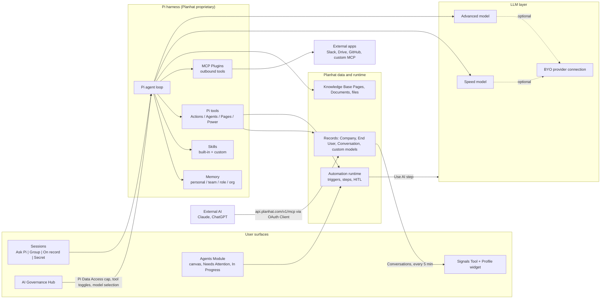
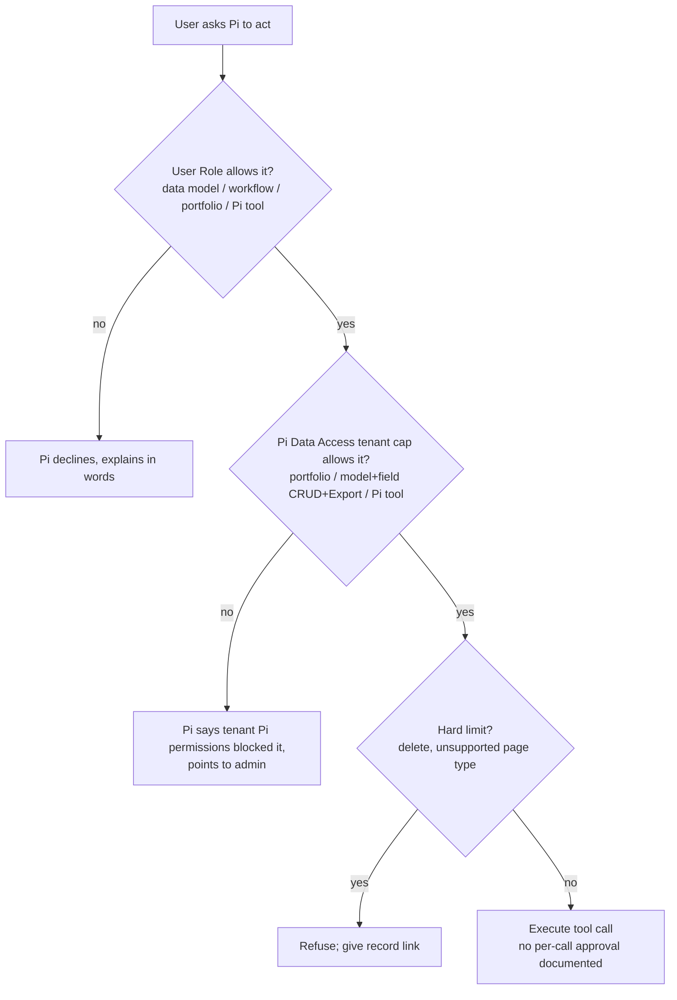
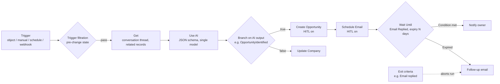
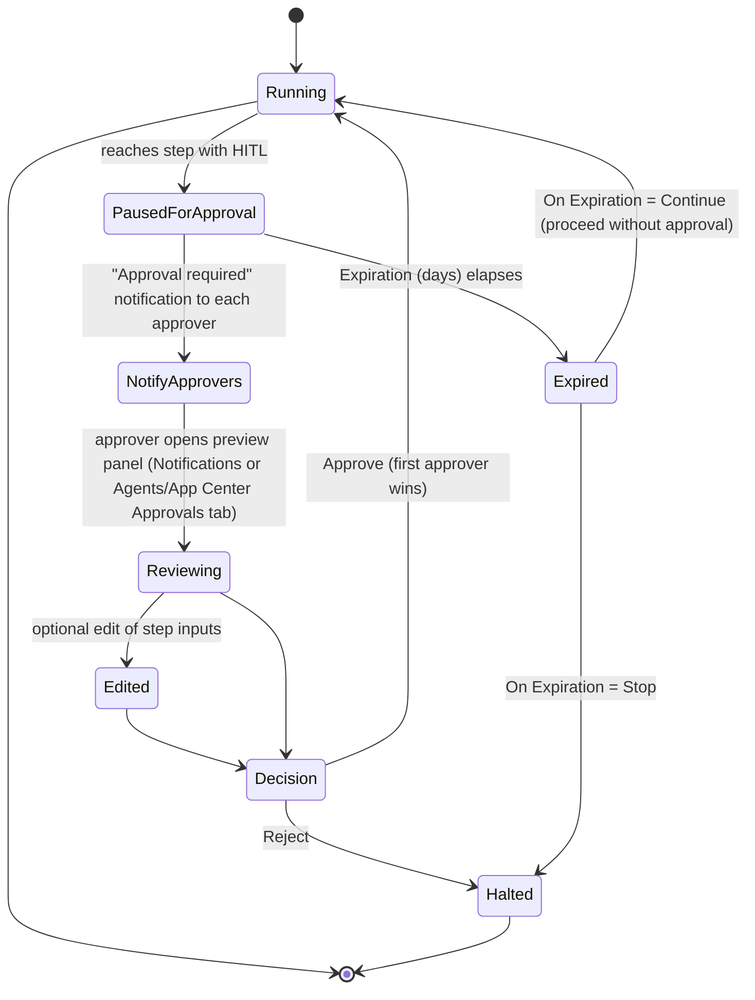

# Planhat agent runtime — architecture reference (Study B)

Public documentation only. Research date: 2026-11-01. Sources: help.planhat.com (Intercom help center), planhat.com/developers, planhat.com/changelog, planhat.com/pi.

Evidence IDs in square brackets (for example [E12]) point to the Evidence ledger in §12. A claim without an ID is a synthesis of cited rows and is marked *(inferred)*.

---

## 0. Coverage and method

| Source | Coverage reached | Notes |
|---|---|---|
| Planhat OS help collection (`/collections/19725252-planhat-os`) | **28 of 28 articles fetched and read.** The 6 Profile articles and Favorites, Revenue Setup and Content Templates articles were scanned for agent content and contain none. | The task said about 27; the collection currently lists 28. |
| AI help collection (11 articles) | 5 read in full: AI overview, "Use AI" steps, Credits and Permissions, AI connections (summary only), plus the OS Governance Hub. | Not read: Conversation Summary, Conversational AI Sentiment/Category, Intended purpose, Get started with AI, the Claude and ChatGPT MCP connection help articles. The developer MCP page was read in their place. |
| Automations sub-collection (21 articles) | Read in full: Overview, Custom Automations, HITL, Schedule Email, Wait Until (first 7k characters), Use AI. Summaries read: Exit criteria, Workflow Mode, Manual triggering, Logs, Failures, Document Pages, Branching. | Not opened: Get, Execute Function, Wait, Webhooks, Slack, Replacement codes, Worked examples, Templated, Choosing between features. |
| planhat.com/developers | Landing page, AI → LLMs, AI → MCP Server, Automations → Triggers. | Not read: Automations → Connections, Flows and Code Execution; the API reference; Data Model. |
| planhat.com/changelog | **Fully exhausted: 107 entries, from October 27, 2026 back to November 1, 2024.** The "Load more" button disappeared after the final load. | Only the first 4 entries are in the static HTML. Older entries arrive through Framer CMS on "Load more", so a plain HTTP fetch will not see them. Ledger rows from those entries are marked `rendered`. |
| planhat.com/pi (marketing) | Scanned for availability wording only. | Marketing; not treated as proof that a feature shipped. |

---

## 1. Pi availability: vendor statements, quoted exactly

Sources disagree. Each statement is recorded separately and none is promoted to "shipped".

| Source (type) | Exact vendor wording | Ledger |
|---|---|---|
| Changelog, September 22, 2026, "Say hi to Pi" (release note) | "Pi is rolling out to a limited set of users" (it continues: over the coming months it will reach all customers) | [C04] |
| planhat.com/pi (marketing) | CTA "Join Waitlist"; the Support use case is labelled "PI FOR Support [beta]" | [P01] [P02] |
| Help: Planhat OS general FAQs | "Sessions and Pi are available to every user, on all plans." | [E69] |
| Changelog, August 3, 2026, "Coworker in multiplayer sessions" (predecessor) | "Generally available in consultation with your deployment team." | [C12] |
| Several help articles | Sub-features are behind feature flags or Labs toggles: Model configuration, MCP Plugins, some Pi tools, "Search the web" | [E45] §3.4, §3.6 |

**Reading** *(inferred)*: The FAQ's "every user, on all plans" most likely means every user *on Planhat OS* has the same Pi features at every plan tier. It does not say that every tenant has Planhat OS. The authoritative rollout statement is the September 22, 2026 release note: limited rollout, with a waitlist on the marketing page. The task brief said "early access"; the vendor does not use that phrase for Pi anywhere I found.

---

## 2. Architecture overview

Key structural facts:
- Pi is the chat agent. Agents are Automations: the Agents Module "is where you see Automations", and both "Create with Pi" and "Create in Canvas" produce "the same kind of Agent (previously called an Automation)" [E51].
- Pi can **build** Automations but cannot **use Skills inside** Automations yet ("Can an Automation or Agent use a Skill?" answered: expected in future) [E28].
- MCP works in both directions. Inbound: external AI reaches Planhat data through the MCP server and OAuth Clients. Outbound: Pi calls external tools through MCP Plugins [E58] [D03].

---

## 3. Pi runtime

### 3.1 Sessions: four modes

| Mode | Visibility | Pi reply behaviour | Searchable by others | Notes |
|---|---|---|---|---|
| Ask Pi ("Just me"; the default) | Only the creator | Replies to every message | No | Personal thinking space |
| Group session | Added Users; "discoverable by other Users and Agents in your Planhat tenant" | Only after `@pi` [E21] | Yes | |
| On record | Anyone with access to the linked record | Only after `@pi` | Follows record access | Replaces pre-OS comments. Topic sessions are a subset (public or private). |
| Secret session | Only added Users | Only after `@pi` | No | "It never enters shared memory" [E20] |

Other Session mechanics: "Each Session is one of 4 modes" [E19]. The mode can be changed after creation. Re-linking a Session to a different record asks for confirmation because participants can lose access. A branched Session inherits its parent's mode. Only the creator (or a chat admin) can delete a Session. Pi Credits cost "from 0 Credits for something very simple, to 10 Credits for something very complex" [E22], against a per-user daily allowance [E23].

Changelog additions: Pi can search past Sessions (September 27, 2026). Pi "can now create new sessions and notify participants" [C09], including from an Automation that fires when a health score drops (October 1, 2026).

### 3.2 Skills

| Property | Value | Ledger |
|---|---|---|
| Built-in | `meeting-prep`, `write-skill` (cannot be edited) | [E24] |
| Name | Lowercase, starts with a letter, letters/digits/hyphens only, max 64 characters, unique per owner | [E25a] |
| Description | Max 200 characters; this is what Pi reads to decide whether to load the Skill automatically | [E25b] |
| Content | Max 16,000 characters | [E25c] |
| Count limit | None "at this time" | — |
| Invocation | `/` picker, typing `/name`, or Pi auto-loads by matching the description | — |
| Creation | Pi interviews the user, shows a draft; "Nothing is saved until you confirm" | [E26] |
| Visibility | Private by default; can be shared to the whole tenant only (not per person); "Pi won't widen a Skill's visibility on its own" | [E27] |
| Tenant-level promotion | "Promoting a personal Skill to tenant level requires admin approval" (October 13, 2026) | [C07] |
| Management UI | None: "there's no settings screen listing your Skills" | [E29] |
| Disable vs delete | Disable hides a Skill and keeps it; delete is permanent | — |
| Use by Automations or Agents | Not available; expected in future | [E28] |

### 3.3 Memory

| Level | Applies to | Who can write | Ledger |
|---|---|---|---|
| Personal | Just you | Only you: "Nobody can write to another User's personal Memory, not even an Admin" | [E36] |
| Team | Team members | "Managers of that Team, and Admins" | [E37] |
| Role | Holders of a Role | Users of that Role | — |
| Organization | Whole tenant | Admins only (changelog October 13, 2026 also restricts tenant-level Memories to admins) | [C07] |

- Limits: "Each Memory is up to 500 characters" [E35], one fact per Memory, optional expiry date.
- Read budget per message is capped. Pi "prioritises your personal Memories, then organization-wide, team, and Role" [E38].
- Confirmed Memories come from explicit standing rules. Unconfirmed Memories are inferred from user corrections; Pi saves them without being asked.
- "Memories are background context, not instructions." [E40] They cannot grant data access.
- No management screen: "As of now, there's no separate screen/menu to manage Memory." [E39]
- "Tenant versus personal": the OS overview calls Memory "specific to each tenant"; inside a tenant there are the four scopes above. Secret sessions never enter *shared* memory [E20]. Whether a Secret session can write a *personal* Memory is **UNKNOWN**.

### 3.4 Pi tools and tool controls

"The default is that all available Pi tools are enabled" [E41]. A tool runs only if it is on in **both** the tenant (Pi Data Access) and the User's Role. "Pi tools are set per Role" [E42]; per-user toggles do not exist. When a tool is off, "Pi will explain in words that it can't do that" [E44], with no error message.

| Category | Pi tool | Badge | Notes |
|---|---|---|---|
| Actions | Create records | Writes data | One record at a time [E33] |
| Actions | Update records | Writes data | |
| Actions | Message colleagues | — | In Sessions, on the user's behalf |
| Actions | Manage chats | — | Rename Sessions, add colleagues, change discoverability |
| Agents | Create automations | Writes data | From plain language |
| Agents | Edit automations | Writes data | |
| Agents | View automation runs | — | |
| Agents | Read automation run logs | — | |
| Pages | Create pages / Edit pages | Writes data | Data Tables, Boards, Documents, Dashboards |
| Pages | Create artifacts / Edit artifacts | Writes data | Live HTML Artifact pages |
| Power | Search the web | Sends data outside Planhat | Help text: "not generally released at the time of writing" [E45]; changelog October 25, 2026 announces it [C01] |
| *(changelog only)* | Draft and send email | presumably Sends data outside Planhat *(inferred)* | Announced October 25, 2026 [C01] [C02]. The Pi tool permissions article does **not** list an email tool, and the Pi capabilities article still lists "Draft or send email on behalf of a user" under *can't do* [E30]. |
| Always on (no switch) | Read/search records, Knowledge Base, Help Center, Pages, attachments, Memory, Skills | — | |

Hard limits: "Pi never deletes a record" [E31]; it returns a link so the user can delete the record. Cross-record text search reads only "the first 200 characters of each field" [E32]. Pi sees current metric values only, not time series. Readable file types: PDF, images, plain text, CSV, Markdown.

### 3.5 Permission layering for Pi

- Pi Data Access has three parts: Portfolio cap (options "Only the User's own portfolio" [E48], No limit, Team portfolio, Filter), data model and field Create/View/Update/Remove/Export caps, and tenant-level Pi tool toggles. It has **no** workflow-permission equivalent.
- "When Pi Data Access has never been set, Pi runs at each User's full Role" [E47].
- "every change is recorded in the tenant security log" [E46].
- Changelog October 11, 2026 adds excluding whole companies: "Exclude specific companies and all their sub-data from Pi's processing" [C11].

### 3.6 MCP

| Direction | Host | Server | Where configured | Auth | Audit |
|---|---|---|---|---|---|
| Outbound (MCP Plugins) | Pi | Slack, Google Drive, GitHub, 20+ templates, any custom MCP server | MCP Plugins Tool (System Configuration; behind a feature flag) | OAuth (recommended), API token, username/password [E63] | "Tool Calls" log records User, Plugin, tool and time [E59] |
| Inbound (Planhat MCP server) | Claude, ChatGPT, custom apps [D03] | `api.planhat.com/v1/mcp` | OAuth Clients in Settings | OAuth client with a maximum scope set by the admin; each user authenticates with their own account [D04] | **UNKNOWN** on the Planhat side |

MCP Plugin connection types: "Two connection types are available" [E58]. **Individual**: each user authorizes their own account and Pi sees what that user sees; recommended for Slack and Drive. **Central**: one shared account, with access granted to Users, Teams or Roles.

Permission layers for a Plugin call: external OAuth scopes, then the user's own external access, then the tools enabled on the Plugin, then the user's own tool toggles, then Pi's judgement. Secrets "are stored encrypted in Planhat" [E64].

Constraints:
- Pi acts only on request: "Pi only acts on your request in a Session" [E61].
- No scheduled pulls: "Automated, scheduled retrieval is not part of MCP Plugins at the time of writing" [E62].
- No inbound triggering from the external app: "Triggering Pi from inside the external app" is not part of this feature [E60].

### 3.7 Bring your own LLM

| Slot | Used for | Minimum model requirements | Ledger |
|---|---|---|---|
| Speed | High-volume or simple work such as Conversation classification and record retrieval | "at least a 250K-token context window", thinking/reasoning mode, strict JSON | [E54] |
| Advanced | Complex work such as Pi-built HTML Artifacts and Custom Automations | Everything above plus "support for tool/function calling"; a frontier model is recommended | [E55] |

- Default for both slots: "Planhat" (managed routing). BYO provider options: OpenAI, Azure, Anthropic/Claude, Gemini, etc. The connection must first be added under Settings → Connections & Integrations → Connections.
- Scope: Pi, "Use AI" steps, conversation classification, Conversation Summary. Changes take up to 30 minutes [E16]. "These settings are configured per tenant, not per user" [E57].
- Cost: BYO removes tenant AI-credit charges for AI features, but "Even if you BYOLLM, when you carry out complex tasks using Pi" Pi Credits are still consumed [E56].
- Access: feature-flagged and requires the "Admin Access" workflow permission.

### 3.8 Pi CRUD matrix (help article dated October 1, 2026)

| Object | Read | Create | Update | Delete |
|---|---|---|---|---|
| Document / Data Table / Revenue Pages | ✅ | ✅ | ✅ | ❌ |
| Dashboard widgets, Presentation widgets | ❌ | ❌ | ❌ | ❌ |
| Fields configuration, Field/Role permissions | ✅ | ❌ | ❌ | ❌ |
| Data model records | ✅ | ✅ | ✅ | ❌ |
| Automations | ✅ | ✅ | ✅ | ❌ |

---

## 4. Agents module (Automations)

### 4.1 Module layout and the canvas

- Module elements, top to bottom: **+ New agent**; **Analytics** (Runs, Success rate, AI credits split into AI/Automation/Email); **Needs Attention** (the user's own approvals and failures, actionable inline, "Up to 10 items show here" [E53]); **In Progress** (live or paused runs); **Agents list** (Mine/All tabs; columns Name, Created by, 7D health, Last run, Runs, Enabled).
- Agent detail panel: Overview, **Canvas** (flowchart; pencil icon to edit), Monitor (failure and disabled notifications, daily failure threshold), **Approvals**, Recent Runs, **Related Sessions** (the chat the agent came from).
- Canvas mechanics: each step gets a random name such as `s-YjM`, used in replacement codes like `<<s-YjM.field>>`. Steps can be added with "+" between blocks. Single steps or whole subtrees can be duplicated (changelog September 4, 2026).

### 4.2 Triggers

| Trigger family | Variants | Permission gate |
|---|---|---|
| Object trigger (any data model, including Attachment) | created, updated (any field or specific fields), deleted, created or updated, added to filter, removed from filter | Data model permissions |
| Manual action | Per model; run from a Profile, a table "play" button, or a bulk action; optional conditions; Action Title and Confirmation Message | — |
| Scheduled | Daily, weekday or weekend, specific day of week, monthly day (from May 29, 2026), hourly variants, 5/10/20/30-minute intervals | "Automation Events - Scheduled" |
| Incoming webhook | UUID endpoint, POST with body only [D01], optional header/payload validation, property filtering | "Automation Events - Call a Webhook" |
| Comments (pre-OS) | Comment triggers Automation (February 2, 2026) | — |
| Pi-initiated | Pi builds or edits Automations; Automations can make Pi open a Session (October 1, 2026) | "Create automations" / "Edit automations" Pi tools |

Trigger modifiers: **Trigger filtration** checks the record's state *before* the change. **Exit criteria** stop a running Automation early (built-in "Email replied", or a custom condition on any model). **Workflow Mode** creates a Workflow record per run so progress and outcomes can be tracked.

### 4.3 Step library

| Category | Step | Purpose / configuration | Automation credit | HITL allowed |
|---|---|---|---|---|
| Planhat Actions | Create | Create a record of any model; set fields, including parent object | 1 | Yes |
| Planhat Actions | Update | Update a record; Team Members add/replace/delete | 1 | Yes |
| Planhat Actions | Get | Fetch related records; GET single with chosen fields; full conversation thread content; external-ID lookup (October 14, 2026) | 1 | Yes |
| Planhat Actions | Wait | Fixed duration or date | 0 | **No** [E04] |
| Planhat Actions | Read File | Single PDF, text or .docx, by path, URL or `<<ref>>`; not in all tenants | 1 *(inferred)* | Yes *(inferred)* |
| Communication | Notify User | In-app notification | 1 | Yes |
| Communication | Send a Slack message | Needs the Slack integration | 1 | Yes |
| Communication | Schedule Email | Sender, recipients (dynamic refs supported), template, merge tags, open/click tracking, reply-in-thread, send windows (September 9, 2026), 1:1 personal mode (October 27, 2026). Sends immediately unless HITL or Wait is used [E74] | 1 *(plus Email credits; inferred from Governance Hub)* | Yes, the recommended placement [E75] |
| Logic and Flow | Branch | Conditional paths | 0 | **No** [E04] |
| Logic and Flow | Wait Until | Waits on email opened/clicked/replied or a custom condition; mandatory expiry; outputs "Condition met" and "Expired" paths | **UNKNOWN** | **UNKNOWN** |
| Logic and Flow | Execute function | JavaScript; gated by "Automation Actions - Raw JS function" [E73] | 1 | Yes |
| AI | Use AI | Provider, Model, Prompt; Text or JSON output; tools such as Websearch [E07] | 1 + AI credits (unless BYO) [E11] | Yes, but recommended on the downstream action |
| Connected Apps | Call a webhook | GET/POST/PUT/PATCH/DELETE, dynamic headers and body | 1 | Yes |
| Connected Apps | Use an integration | A configured Connection, for example an AI provider | 1 | Yes |
| Documents | Read / Create Document Page | Text, Markdown, HTML or PH Doc JSON; public or private, view or edit | 1 *(inferred)* | Yes *(inferred)* |
| Portals | Create Portal | From March 31, 2026 | **UNKNOWN** | **UNKNOWN** |

Credits: "Triggers (what initiates the Automation)", Branch and Wait steps cost no Automation Credits [E71]. Per-Automation **Task execution limit** caps step executions per 30 days; "This is evaluated once a day at 12 noon UTC." [E72]. A daily failure threshold auto-disables an Automation that fails too often.

### 4.4 The "Use AI" step

- Inputs: "The AI step takes a model, a connection and a prompt as input" [E08]. The UI fields are Provider (Planhat-managed or own connection), Model and Prompt (with `<<ref | toMarkdown>>` formatting).
- Output: Text, or JSON configured through "Configure Schema".
  - **Custom properties**: name (no spaces), type (text, number, boolean, List, Array+List), description, required flag.
  - **Model properties**: pulled from a Planhat data model's field settings and kept in sync.
- **Single-model constraint**: "You can't have fields from multiple models in the schema" [E09], and "if you change the model you need to setup the configuration again" [E10]. To create a Company update *and* an Issue from one transcript, use custom properties or several AI steps *(inferred)*.
- Tools: "The AI step also has tools available, e.g. Websearch" [E07].
- Logging: responses appear in Automation logs for 30 days and are saved in the database only if a later step saves them.
- Documented failure modes: provider 429 rate limits, invalid or truncated JSON, context-length exceeded, model not entitled (403), MAX_TOKENS, Vertex resource exhausted.

### 4.5 Building an agent from chat and activating it

1. Agents Module → "+ New agent" → "Create with Pi". Describe the trigger and steps in plain language; prompts can include instructions such as "Enable HITL for email step".
2. "Review what's been produced before you switch it on" [E50]. Activation is the **Enabled** toggle.
3. The originating Session is kept under **Related Sessions**. The vendor calls the original description "the closest thing to a specification".
4. A Pi-built agent can be edited afterwards on the canvas.

Whether Pi-built agents start *disabled* is **UNKNOWN** *(the review advice implies it but does not state it)*.

---

## 5. Human-in-the-Loop (HITL)

### 5.1 Configuration (per step)

| Element | Values | Ledger |
|---|---|---|
| Eligible steps | "most step types" except "not Wait steps or Branch steps, and not including triggers" | [E04] |
| Approver | One or more Users, or a dynamic reference such as `<<object.owner>>`. The changelog says "users or roles" [C06]; the help article shows Users and replacement codes. | [C06] |
| Expiration (days) | Number | — |
| On Expiration | "Stop (Halt automation)" or "Continue (Proceed without approval)" | [E01] [E02] |
| Multiple HITL steps | Allowed in one Automation | — |
| Access | Help article: Planhat Labs toggle [E05]. Changelog June 30, 2026: "Available to all customers." [C05b] | conflict |

### 5.2 Approval flow and queue

- **Two decision surfaces**: Planhat notifications, and the Automation's **Approvals** tab ("Pending" and "All approvals" history) [E08b]. In Planhat OS the module also shows **Needs Attention** rows with inline approve/reject [E49], but "This shows your own notifications" [E52], so there is no tenant-wide queue.
- **Multiple approvers**: all are notified; "Only one approver needs to actually do the approval/rejection" [E03]. The other approvers' notifications update to show no action is needed.
- **Non-approvers** see "You do not have permission to approve or reject this request" [E06b].
- **History**: "you can see the history of approvals for that Automation" [E06], including who approved.
- Stalled-run signal: In Progress shows elapsed time; a long-running item usually means it is waiting on HITL.

### 5.3 Are Pi's own tool actions gated?

| Pi action | Documented gate | Ledger |
|---|---|---|
| Create/update records, pages, artifacts, automations | Role ∩ Pi Data Access ∩ Pi tool toggles. **No per-action approval prompt is documented.** Admins can switch tools off so humans do those actions manually. | [E41] [E42] |
| Save a Skill | Draft shown; "Nothing is saved until you confirm" | [E26] |
| Delete | Never; Pi returns a link to the record instead | [E31] |
| Promote a Skill or Memory to tenant level | Admin approval / admin-only | [C07] |
| MCP Plugin tool (including writes) | User tool toggles; Pi acts only on the user's request; Pi asks a clarifying question when the request is ambiguous | [E61] |
| **Email send by Pi** (October 25, 2026) | Only "Admins choose whether each tool is available, using Pi's tool controls" (changelog wording). **Whether Pi asks for confirmation before sending is UNKNOWN.** The help article still lists email under *can't do* [E30]. | [C01] [C02] |
| Email send from an Automation | **Ungated unless HITL is set on the Schedule Email step** | [E74] |

---

## 6. AI governance

### 6.1 Credit meters (three separate pools plus Email)

| Meter | Scope | Allowance / reset | Consumed by | Ledger |
|---|---|---|---|---|
| Tenant AI credits | Tenant-shared | "every customer instance receives 10,000 AI credits on a rolling 30-day basis" | Use AI on managed LLMs, classification, Conversation Summary | [E12] |
| Automation Credits | Tenant | Monthly quota by plan | About 1 per executed step (trigger, Branch and Wait are free) | [E71] |
| Pi Credits | Per user | Daily allowance by User Type; simple queries are free; 0–10 per request | Pi in Sessions; **still consumed when BYO LLM is used** | [E22] [E23] [E56] |
| Email credits | Tenant | **UNKNOWN** | Email automations (shown in the Governance Hub and Analytics breakdown) | — |

When the limit is reached: "When you've reached your limit, the AI features can no longer be used" [E14], with an in-app banner. The general FAQs state Pi chat credits are "separate from your tenant's AI credits, which are reserved for running Automations" [E70].

### 6.2 AI Governance Hub (Agents Module → Governance → More; needs "Admin Access")

| Panel | Contents |
|---|---|
| Trust Center | Link to policies, data flows, certifications |
| Feature controls | 30-day credit usage; Classify Conversations toggle; backfill window (Starting today / 30 / 90 days); Classification rule |
| Model configuration | Model selection for Speed and Advanced (feature flag) [E17] [E18] |
| Pi Data Access | Tenant cap (§3.5) [E15] |
| Credits Usage | AI, Automations, Email, Per User (Pi Credits per user) |
| Recommended tools | One-step recommended Pi tool set, with a banner explaining its safeguards (changelog October 15, 2026) [C10] |

### 6.3 Audit and logging inventory

| Artifact | What it records | Retention | Ledger |
|---|---|---|---|
| Automation logs / Automation Runs UI | Trigger, step setup at execution time, step status, outputs | AI responses: 30 days; run log retention otherwise **UNKNOWN** | — |
| HITL "All approvals" | Pending and resolved approvals, approver identity | **UNKNOWN** | [E06] |
| MCP Plugin "Tool Calls" | User, Plugin, tool, time | **UNKNOWN** | [E59] |
| Tenant security log | Pi Data Access changes | **UNKNOWN** | [E46] |
| Prompt audit logs | Listed as a paid AI-credit upgrade feature | **UNKNOWN** | [E13] |
| Pi native tool-call audit (non-MCP) | **Not documented** | — | — |
| Related Sessions on an agent | Provenance of chat-built agents | — | — |

---

## 7. Signals (context feed for agents)

- Inputs: Conversations created or updated in the last 30 days that have real content (emails, chats or tickets with more than one part, or any call or meeting), plus field-update events (read-only and calculated fields excluded).
- Cadence: "Planhat checks for new Conversations to analyze every five minutes" [E67].
- Output: headline, one of 10 fixed categories ("This list is fixed." [E66]): Budget concern, Champion change, Churn risk, Competitor mention, Escalation, Expansion, Onboarding struggle, Positive feedback, Product issue, Renewal hesitation. Falls back to "Conversation". The most significant carry a "Priority" badge.
- Retention: "Each Signal is kept for 30 days." [E65]. Ranking is personalised by ownership.
- Not yet possible: dismissing a Signal or giving feedback [E68], notifications, reporting or filtering, per-account opt-out.
- Signals cannot be used as Automation triggers or filters ("Can I report on Signals, or use them in a filter or Dashboard? Not at this time") *(inferred: no trigger is documented)*.
- The changelog has **no dedicated Signals launch entry**; Signals are mentioned only on October 10, 2026, as a recommended default view.

---

## 8. Trigger → context → action → human gate

| Actor / entry | Trigger | Context read | Actions it can take | Human gate |
|---|---|---|---|---|
| Pi, Ask Pi session | Every user message | Records within Role ∩ Data Access; Knowledge Base; Documents; files; Memory; Skills; Help Center; MCP Plugin tools | Create/update records (one at a time); pages and artifacts; create/edit automations; message colleagues; manage chats; web search and email (October 25, 2026) | Tool toggles (Role + tenant). No per-action confirmation documented. Skill save needs confirmation. Never deletes. |
| Pi, Group / On record / Secret session | `@pi` mention | Same, plus the Session thread; Secret stays out of shared memory | Same | Same; other participants can see what Pi does |
| Pi, Create with Pi (agent builder) | User describes an agent | Data model and field metadata; Planhat Help Center | Creates an Automation (Agent) | User reviews, then turns on **Enabled**; "Create automations" tool can be disabled |
| Automation calling Pi | Automation trigger (for example a health-score drop) | Automation context | Pi opens a Session and notifies participants (October 1, 2026) | **UNKNOWN** |
| Custom Automation, object trigger | Record create/update/delete or filter enter/exit, after trigger filtration | Trigger object, Get steps, Read File, Documents | Create/Update/Notify/Slack/Email/Webhook/JS/Use AI/Portal | Optional HITL per step (not Wait, Branch or trigger); expiry Stop or Continue; Exit criteria |
| Custom Automation, manual action | User clicks on a Profile, table row or bulk selection | Selected record(s) | Same | The click itself, plus confirmation message and optional HITL |
| Custom Automation, scheduled | Cron-like schedule | Get steps across the portfolio | Same | Optional HITL; task execution limit |
| Custom Automation, incoming webhook | External POST | Payload | Same | Optional HITL; header/payload validation |
| Signals engine | New or updated eligible Conversation (5-minute poll), field change | Conversation content | Creates a Signal (headline, category, priority) | None; no dismiss or feedback |
| Conversation classification | Incoming Conversations matching the classification rule | Conversation | Writes sentiment and category; rolls up a 90-day weighted score | None after the admin enables it |
| Pi via MCP Plugin | User request in a Session | External app data under the user's (Individual) or shared (Central) identity | Read; write where the Plugin exposes write tools | Per-user tool toggles; no confirmation documented |
| External AI via Planhat MCP server | Claude/ChatGPT user query | Planhat data within OAuth Client scope ∩ user permissions | Read and act on records; read and create Documents (June 23, 2026) | OAuth consent; admin maximum scope |

---

## 9. Changelog extract: Pi, agents, HITL, MCP, signals, automations (newest first)

Full depth: 107 entries (October 27, 2026 back to November 1, 2024). Unrelated entries (Salesforce, Portals UI, Teams, timesheets, tables) are omitted.

| Date | Title | Gist |
|---|---|---|
| 2026-10-27 | Send more personal emails from automations | 1:1 personal emails from the Email step; replies include the original thread |
| 2026-10-25 | Let Pi search the web and send emails for you | Pi web search and draft+send email; admins control availability with Pi tool controls |
| 2026-10-24 | Get notified only about what you follow | Subscribe to Session notifications per profile or Topic; nobody is subscribed by default |
| 2026-10-18 | Ask Pi about the records in your Global Filters | Pi resolves Global Filters by name |
| 2026-10-15 | Choose which tools Pi can use | Per-tool on/off for the workspace; recommended tool set on the Governance page |
| 2026-10-14 | Look up records with your own IDs | External-ID lookups in the API and the Get step |
| 2026-10-13 | Manage tenant-level Memories and Skills with admin permissions | Tenant-level Memories/Skills are admin-only; promotion needs admin approval |
| 2026-10-11 | Control what data Pi can access | Model/property exclusions; exclude whole companies |
| 2026-10-10 | Set Recommended Tools… | Default Signals, Agents and views per user group |
| 2026-10-05 | Power Planhat's AI with your own AI provider | BYO provider for Pi and AI steps, opt-in |
| 2026-10-03 | Get answers from the Help Center directly in Pi | Help Center as a Pi knowledge source |
| 2026-10-01 | Let Pi start sessions and bring in participants | Pi creates Sessions and notifies people, including when triggered from an Automation |
| 2026-09-27 | Search and reason across your OS sessions with Pi | Session-history retrieval |
| 2026-09-25 | Manage AI usage, models and controls from the AI Governance Hub | Governance Hub launched |
| 2026-09-23 | Connect Pi to external tools through MCP | MCP Plugins, 20+ connectors |
| 2026-09-22 | **Say hi to Pi** | Pi launch; "rolling out to a limited set of users" |
| 2026-09-14 | Track sequence progress and outcomes with Workflow Mode | Workflow record per run |
| 2026-09-11 | Target low adoption accounts with AI powered outreach | AI template |
| 2026-09-10 | Triage inbound inquiries with an AI shared inbox | AI template: drafts replies or creates tasks |
| 2026-09-09 | Schedule send windows for Automation email steps | Send windows |
| 2026-09-08 | Follow up on NPS responses automatically… | Template |
| 2026-09-06 | Enrol users into a multi-language onboarding sequence… | Template |
| 2026-09-04 | Duplicate steps on the Automations canvas | Canvas copy |
| 2026-09-03 | Pause an Automation until a condition is met | Wait Until step |
| 2026-09-01 | Set exit criteria to remove records from a running Automation | Exit criteria |
| 2026-08-28 | Build email sequences within Automations… | Sequences in Automations; AI content + HITL |
| 2026-08-03 | Coworker in multiplayer sessions | Pi predecessor; "Generally available in consultation with your deployment team." |
| 2026-07-10 | Send and schedule AI-enabled email sequences from Automation | Schedule Email step |
| 2026-07-02 | Connect third-party apps and AI tools… OAuth Clients | OAuth Clients GA; powers MCP |
| 2026-06-30 | **Add human review to any step in an Automation** | HITL; users or roles; timeouts and fallback; "Available to all customers." |
| 2026-06-25 | Upload and export Planhat Documents as markdown | `.md` round-trip for agents |
| 2026-06-23 | Read and create Planhat documents through MCP | MCP server Documents support |
| 2026-06-19 | Set OAuth permissions automatically when connecting to MCP | Admin maximum scope enforced |
| 2026-06-08 | Build Automations faster with smarter field-filling… | Smart-fill from earlier steps, including AI outputs |
| 2026-06-01 | Use Claude Opus 4.8 in AI Automations | Model |
| 2026-05-29 | Schedule Automations to run on a specific day of the month | Monthly trigger |
| 2026-05-25 | Activate AI automations from the App Library with one click | 5 AI templates |
| 2026-05-11 | See credit consumption broken down by Automation and AI feature | Credits Usage page |
| 2026-05-08 | Use Anthropic's Opus 4.7 model in AI Automations | Model |
| 2026-05-06 | View AI credit consumption per Automation in App Center | Per-automation AI credits |
| 2026-04-13 | View full execution logs for every Automation Run | Runs UI |
| 2026-03-31 | Create and customize Portals through Automations | Create Portal step |
| 2026-03-30 | Latest frontier LLM models now available in Automations | Models |
| 2026-03-26 | OAuth connections now available in Labs | Labs |
| 2026-03-17 | Set parent objects in Automation Create and Update steps | Steps |
| 2026-03-16 | Higher thresholds for error in Automations | Failure threshold |
| 2026-02-27 | Analyze and Extract Information from Files in Automations | Read File step |
| 2026-02-17 | Introducing OpenAI GPT-5.2 in Automations | Model |
| 2026-02-16 | Introducing Planhat Labs | Private-beta programme |
| 2026-02-02 | Trigger Automations with Comments | Trigger |
| 2026-01-09 | Smarter, More Consistent AI Workflows with Structured Output… | Model-property schemas |
| 2025-12-11 | Automations Run status and call summaries | Run status; call-summary templates |
| 2025-12-09 | Opus 4.5, Haiku 4.5… managing Automations | Models |
| 2025-11-21 | AI Workflow formatting… | Structured (JSON) output from AI steps |
| 2025-11-05 | User Types, Customise Automation Templates… | Core/Productivity/View User Types; template → custom |
| 2025-10-24 | Run Automations with Buttons and Bulk-Actions | Manual/bulk triggers |
| 2025-10-17 | Improved Automations, Analyse Conversation Content… | Full thread in Get; actionable notifications |
| 2025-10-08 | Sonnet 4.5… | Model |
| 2025-10-01 | Configure Conversational AI | Classification rules and backfill |
| 2025-09-17 | Portal and Automation Upgrades | Get step UI |
| 2025-09-11 | Upgrading Planhat AI Platform (AIP) | Use AI step; "MCP… server for external agents [beta]" |
| 2025-05-28 | Improved Global Search, Automations… | Manual action trigger |
| 2025-04-02 | Automations, Upgraded | Flowchart UI; branching |
| 2025-02-04 | Smarter Workflows, Deeper Insights | Field Rules approval flows |
| 2024-11-01 | AI Automations, Marketing Emails | First AI Automation templates |

---

## 10. Design recommendations (observed pattern → our design choice)

| # | Observed in Planhat | Our design choice |
|---|---|---|
| 1 | Pi permission = Role ∩ tenant Pi Data Access ∩ per-tool toggle; toggles only narrow access [E15] [E42] | **Adopt.** Enforce at the tool-dispatch layer and return a typed "blocked by: role / tenant cap / tool" reason, matching Planhat's "Pi tells you it was blocked". |
| 2 | HITL is per step with Approver, Expiration (days) and On Expiration Stop or Continue [E01] [E02] | **Adopt, but tighten.** Disallow "Continue on expiry" for steps with side effects outside the product (email, webhook) or deletes. Default expiry to Stop. |
| 3 | HITL goes on the *action* step after Use AI, not on the AI step [E75] | **Adopt.** Store the AI draft, the approver's edits and the final payload as three versions, so the audit shows what the human changed. |
| 4 | First approver wins; the queue is per user ("This shows your own notifications") [E03] [E52] | **Extend.** Add a tenant-wide admin approvals view with age and SLA, plus a fallback approver when a dynamic approver (`<<object.owner>>`) resolves to nobody (behaviour UNKNOWN in Planhat). |
| 5 | Interactive Pi tool calls have no per-call confirmation; only tool on/off. Email send was added October 25, 2026 without a documented confirmation step [C01] | **Diverge.** Make external sends (email, external writes through MCP) draft-first with an explicit user confirmation in chat; make bulk writes previewable. Mark each tool `writes` / `external` / `irreversible` and require confirmation for the latter two. |
| 6 | Pi never deletes; returns a record link [E31] | **Adopt** as an invariant, including no "clear all fields" imitation of a delete. |
| 7 | Use AI structured output is limited to one data model per schema [E09] | **Diverge.** Allow a typed envelope with per-object sub-schemas (for example `{company:{…}, issues:[…], risks:[…]}`) validated before any write. This is needed for transcript → multi-record extraction. |
| 8 | Chat-built agents keep their source Session ("Related Sessions") as the specification | **Adopt.** Persist the originating prompt and conversation on the agent record, and show it in diffs when the agent is edited. |
| 9 | Audit is fragmented: MCP Tool Calls, tenant security log, Automation runs, approvals history; prompt audit is a paid upsell; Pi native tool-call audit is undocumented [E13] [E59] | **Diverge.** One append-only agent-action log for every tool call (native and MCP): actor, on-behalf-of user, inputs hash, outputs, gate decisions. Do not paywall it. |
| 10 | Three credit meters (tenant AI 30-day rolling, Automation monthly, Pi daily per user), plus Email | **Simplify.** One ledger with per-feature and per-agent attribution. Keep Planhat's per-agent **task execution limit** and daily failure auto-disable as circuit breakers. |
| 11 | Memory has 4 scopes with write rights, confirmed vs inferred entries, 500-character facts, a priority-ordered read budget, and no management screen [E38] [E39] | **Adopt the model; add a UI.** Provide a reviewable memory list. Inferred memories stay "unconfirmed" until accepted. Org-level writes are admin-only. |
| 12 | Skills: 64/200/16k-character limits, auto-load by description, tenant promotion needs admin approval; not usable by Automations [E28] | **Adopt and extend.** Let agents reference versioned Skills, so chat and automation share one procedure. |
| 13 | A Secret session "never enters shared memory" [E20] | **Adopt** as a privacy mode that also excludes the session from org search and from agent context. |
| 14 | Signals: fixed taxonomy of 10, 30-day TTL, 5-minute polling; no dismiss, feedback, triggers or filters [E65]–[E68] | **Diverge.** Make signals first-class records: feedback (wrong / useful), and usable as agent triggers. Keep a configurable taxonomy. |
| 15 | MCP: Individual vs Central connections; per-user tool toggles; no scheduled pulls; no inbound trigger [E62] | **Adopt Individual-by-default.** Treat scheduled retrieval as an Automation step, not a Pi behaviour, so it inherits HITL and credit controls. |
| 16 | Availability is spread across feature flags, Labs toggles, waitlists and help text that contradicts the changelog | **Diverge.** Expose a machine-readable capability and availability endpoint per tenant, so agents and admins see what is actually enabled. |

---

## 11. UNKNOWN (not established by public docs read)

1. **Pi email send gating**: whether Pi confirms before sending; whether the email tool appears in Pi tool permissions; which credit meter it uses. The help articles predate or contradict the October 25, 2026 changelog.
2. **Pi availability per tenant**: the definitive GA date; whether "every user" in the FAQs means every Planhat OS tenant; the size of the "limited set".
3. **Audit of Pi's native (non-MCP) tool calls**: whether they are logged, where, and for how long.
4. **HITL details**: whether roles (changelog) are selectable as approvers in the UI; behaviour when a dynamic approver resolves to nobody; maximum expiration; whether HITL works on Wait Until, Read File, Create Portal or Document steps; whether reject has its own path; whether approval edits are versioned.
5. **HITL availability**: the Labs toggle (help) versus "Available to all customers" (changelog, June 30, 2026).
6. **Pi-triggered Sessions from Automations** (October 1, 2026): the step name, configuration, and any human gate.
7. **Create with Pi**: whether the agent is created disabled; whether Pi can enable it itself.
8. **Credit values**: per-model AI-credit rates; Pi Credit daily allowance per User Type; Email credit allowance; the monthly Automation Credit quota by plan.
9. **Retention**: Automation run logs (beyond 30 days for AI responses), approvals history, MCP Tool Calls, security log.
10. **Memory**: the per-message read-budget size; whether Secret sessions can write personal Memories; whether Agents read Memory.
11. **Pi "Personal Agents"**: listed in the OS overview contents with no section body in the fetched text.
12. **Planhat MCP server tool catalogue** (only `get_model_actions` and `get_model_action_parameters` appear in error text) and server-side audit.
13. **Developer pages not read**: Automations → Connections, Flows and Code Execution; Data Model.
14. **AI help articles not read**: Conversation Summary, Sentiment/Category, Intended purpose, Get started, the Claude/ChatGPT connection articles. **Automation articles not opened**: Get, Execute Function, Wait, Webhooks, Slack, Replacement codes, Worked examples, Templated, Choosing.
15. **Signals**: model used, significance threshold, whether Signals consume credits, and whether BYO LLM applies.

---

## 12. Evidence ledger

`check` values:
- `static`: the quote appears in the fetched page's parsed DOM text with whitespace collapsed. Verified for all `static` rows on 2026-11-01 (81 help-center checks and 11 planhat.com checks passed).
- `rendered`: the quote is only present after browser "Load more" on the Framer changelog; a plain fetch will not find it.
- `inferred`: no verbatim quote.

| ID | Claim | URL | Verbatim quote (≤15 words) | check |
|---|---|---|---|---|
| E01 | HITL expiry option: halt | https://help.planhat.com/en/articles/15535091-human-in-the-loop-hitl-in-automations | Stop (Halt automation) | static |
| E02 | HITL expiry option: continue | https://help.planhat.com/en/articles/15535091-human-in-the-loop-hitl-in-automations | Continue (Proceed without approval) | static |
| E03 | First approver decides | https://help.planhat.com/en/articles/15535091-human-in-the-loop-hitl-in-automations | Only one approver needs to actually do the approval/rejection | static |
| E04 | HITL not on Wait, Branch or triggers | https://help.planhat.com/en/articles/15535091-human-in-the-loop-hitl-in-automations | not Wait steps or Branch steps, and not including triggers | static |
| E05 | HITL behind a Labs toggle (help) | https://help.planhat.com/en/articles/15535091-human-in-the-loop-hitl-in-automations | access to HITL in Automations is controlled via a toggle switch within Planhat Labs | static |
| E06 | Approval history | https://help.planhat.com/en/articles/15535091-human-in-the-loop-hitl-in-automations | you can see the history of approvals for that Automation | static |
| E06b | Non-approver message | https://help.planhat.com/en/articles/15535091-human-in-the-loop-hitl-in-automations | You do not have permission to approve or reject this request | static |
| E08b | Two approval surfaces | https://help.planhat.com/en/articles/15535091-human-in-the-loop-hitl-in-automations | Approvers can do this review/approval from either their Planhat notifications | static |
| E07 | Use AI has tools such as web search | https://help.planhat.com/en/articles/11812698-use-ai-steps-in-automations | The AI step also has tools available, e.g. Websearch | static |
| E08 | Use AI inputs | https://help.planhat.com/en/articles/11812698-use-ai-steps-in-automations | The AI step takes a model, a connection and a prompt as input | static |
| E09 | Single-model schema constraint | https://help.planhat.com/en/articles/11812698-use-ai-steps-in-automations | You can't have fields from multiple models in the schema | static |
| E10 | Changing the model resets the schema | https://help.planhat.com/en/articles/11812698-use-ai-steps-in-automations | if you change the model you need to setup the configuration again | static |
| E11 | AI steps also cost AI credits | https://help.planhat.com/en/articles/9590728-custom-automations | AI steps consume AI Credits, unless you're using your own AI connections | static |
| E71 | Triggers cost no Automation Credits | https://help.planhat.com/en/articles/9590728-custom-automations | Triggers (what initiates the Automation) | static |
| E72 | Task execution limit evaluation time | https://help.planhat.com/en/articles/9590728-custom-automations | This is evaluated once a day at 12 noon UTC. | static |
| E73 | JS step permission | https://help.planhat.com/en/articles/9590728-custom-automations | Automation Actions - Raw JS function | static |
| E73b | Custom Automations billing | https://help.planhat.com/en/articles/9590728-custom-automations | Custom Automations are charged through Automation Credits | static |
| E12 | Tenant AI credit allowance | https://help.planhat.com/en/articles/11813533-planhat-ai-credits-and-permissions | every customer instance receives 10,000 AI credits on a rolling 30-day basis | static |
| E13 | Prompt audit logs are an upgrade feature | https://help.planhat.com/en/articles/11813533-planhat-ai-credits-and-permissions | Prompt audit logs | static |
| E14 | Hard stop at the credit limit | https://help.planhat.com/en/articles/11813533-planhat-ai-credits-and-permissions | When you've reached your limit, the AI features can no longer be used | static |
| E15 | Data Access only narrows | https://help.planhat.com/en/articles/17313953-planhat-os-ai-governance-hub | The Pi Data Access settings only ever narrow what Pi can do | static |
| E16 | Model change latency | https://help.planhat.com/en/articles/17313953-planhat-os-ai-governance-hub | Changes can take up to 30 minutes to take effect | static |
| E17 | Speed slot | https://help.planhat.com/en/articles/17313953-planhat-os-ai-governance-hub | Speed - for quick, simple work | static |
| E18 | Advanced slot | https://help.planhat.com/en/articles/17313953-planhat-os-ai-governance-hub | Advanced - for complex tasks that need more capabilities | static |
| E19 | Four Session modes | https://help.planhat.com/en/articles/16597603-planhat-os-sessions | Each Session is one of 4 modes | static |
| E20 | Secret sessions stay out of shared memory | https://help.planhat.com/en/articles/16597603-planhat-os-sessions | It never enters shared memory | static |
| E21 | `@pi` required outside Ask Pi | https://help.planhat.com/en/articles/16597603-planhat-os-sessions | Pi will only respond once it's been invited into the Session by @-mentioning (@pi) | static |
| E22 | Pi Credit range | https://help.planhat.com/en/articles/16597603-planhat-os-sessions | from 0 Credits for something very simple, to 10 Credits for something very complex | static |
| E23 | Daily per-user Pi allowance | https://help.planhat.com/en/articles/16597603-planhat-os-sessions | Each Planhat User has a daily allowance of Pi Credits, depending on the User Type | static |
| E24 | Built-in Skills | https://help.planhat.com/en/articles/16307128-planhat-os-skills | Planhat OS comes with two built-in Skills: meeting-prep and write-skill | static |
| E25a | Skill name limit | https://help.planhat.com/en/articles/16307128-planhat-os-skills | Up to 64 characters | static |
| E25b | Skill description limit | https://help.planhat.com/en/articles/16307128-planhat-os-skills | Up to 200 characters | static |
| E25c | Skill content limit | https://help.planhat.com/en/articles/16307128-planhat-os-skills | Up to 16,000 characters | static |
| E26 | Skill save needs confirmation | https://help.planhat.com/en/articles/16307128-planhat-os-skills | Nothing is saved until you confirm | static |
| E27 | Pi does not self-share Skills | https://help.planhat.com/en/articles/16307128-planhat-os-skills | Pi won't widen a Skill's visibility on its own | static |
| E28 | Automations can't use Skills yet | https://help.planhat.com/en/articles/16307128-planhat-os-skills | Can an Automation or Agent use a Skill? | static |
| E29 | No Skills settings screen | https://help.planhat.com/en/articles/16307128-planhat-os-skills | there's no settings screen listing your Skills | static |
| E30 | Pi cannot email (as of the help article) | https://help.planhat.com/en/articles/17228679-planhat-os-pi-capabilities | Draft or send email on behalf of a user | static |
| E31 | Pi never deletes | https://help.planhat.com/en/articles/17228679-planhat-os-pi-capabilities | Pi never deletes a record | static |
| E32 | Cross-record text truncation | https://help.planhat.com/en/articles/17228679-planhat-os-pi-capabilities | Pi reads the first 200 characters of each field | static |
| E33 | One record at a time | https://help.planhat.com/en/articles/17228679-planhat-os-pi-capabilities | one at a time, after checking which fields the model has | static |
| E34 | Memory levels | https://help.planhat.com/en/articles/17279163-planhat-os-memory | Memory has four levels | static |
| E35 | Memory size | https://help.planhat.com/en/articles/17279163-planhat-os-memory | Each Memory is up to 500 characters | static |
| E36 | Personal Memory is inviolable | https://help.planhat.com/en/articles/17279163-planhat-os-memory | Nobody can write to another User's personal Memory, not even an Admin | static |
| E37 | Team Memory writers | https://help.planhat.com/en/articles/17279163-planhat-os-memory | Managers of that Team, and Admins | static |
| E38 | Memory read priority | https://help.planhat.com/en/articles/17279163-planhat-os-memory | Pi prioritises your personal Memories, then organization-wide, team, and Role | static |
| E39 | No Memory UI | https://help.planhat.com/en/articles/17279163-planhat-os-memory | As of now, there's no separate screen/menu to manage Memory. | static |
| E40 | Memory is not instructions | https://help.planhat.com/en/articles/17279163-planhat-os-memory | Memories are background context, not instructions. | static |
| E41 | Pi tools on by default | https://help.planhat.com/en/articles/17733470-planhat-os-pi-tool-permissions | The default is that all available Pi tools are enabled | static |
| E42 | Per-Role, not per-user | https://help.planhat.com/en/articles/17733470-planhat-os-pi-tool-permissions | Pi tools are set per Role | static |
| E43 | "Writes data" badge meaning | https://help.planhat.com/en/articles/17733470-planhat-os-pi-tool-permissions | creates or changes something in Planhat | static |
| E44 | Disabled tool behaviour | https://help.planhat.com/en/articles/17733470-planhat-os-pi-tool-permissions | Pi will explain in words that it can't do that | static |
| E45 | Web search not GA (help) | https://help.planhat.com/en/articles/17733470-planhat-os-pi-tool-permissions | note that this functionality is not generally released at the time of writing | static |
| E46 | Data Access changes logged | https://help.planhat.com/en/articles/17278373-planhat-os-pi-data-access | every change is recorded in the tenant security log | static |
| E47 | No cap by default | https://help.planhat.com/en/articles/17278373-planhat-os-pi-data-access | When Pi Data Access has never been set, Pi runs at each User's full Role | static |
| E48 | Portfolio cap option | https://help.planhat.com/en/articles/17278373-planhat-os-pi-data-access | Only the User's own portfolio | static |
| E49 | Inline approvals in the Agents Module | https://help.planhat.com/en/articles/16307194-planhat-os-agents-module | Approvals and failures are gathered in one place and can be actioned inline | static |
| E50 | Review before enabling | https://help.planhat.com/en/articles/16307194-planhat-os-agents-module | Review what's been produced before you switch it on | static |
| E51 | Agent = Automation | https://help.planhat.com/en/articles/16307194-planhat-os-agents-module | Both produce the same kind of Agent (previously called an Automation) | static |
| E52 | Queue is per user | https://help.planhat.com/en/articles/16307194-planhat-os-agents-module | This shows your own notifications | static |
| E53 | Needs Attention item limit | https://help.planhat.com/en/articles/16307194-planhat-os-agents-module | Up to 10 items show here | static |
| E54 | Speed model requirement | https://help.planhat.com/en/articles/17229796-planhat-os-bring-your-own-llm-byollm | at least a 250K-token context window | static |
| E55 | Advanced model requirement | https://help.planhat.com/en/articles/17229796-planhat-os-bring-your-own-llm-byollm | support for tool/function calling | static |
| E56 | Pi Credits consumed even with BYO | https://help.planhat.com/en/articles/17229796-planhat-os-bring-your-own-llm-byollm | Even if you BYOLLM, when you carry out complex tasks using Pi | static |
| E57 | BYO is per tenant | https://help.planhat.com/en/articles/17229796-planhat-os-bring-your-own-llm-byollm | These settings are configured per tenant, not per user | static |
| E58 | MCP connection types | https://help.planhat.com/en/articles/17310389-planhat-os-mcp-plugins-overview | Two connection types are available | static |
| E59 | MCP tool-call audit | https://help.planhat.com/en/articles/17310485-planhat-os-mcp-plugins-setup-and-management-guide-for-admins | Planhat records every tool call, including who made it and when | static |
| E60 | No inbound trigger from external apps | https://help.planhat.com/en/articles/17310485-planhat-os-mcp-plugins-setup-and-management-guide-for-admins | Triggering Pi from inside the external app | static |
| E63 | MCP auth methods | https://help.planhat.com/en/articles/17310485-planhat-os-mcp-plugins-setup-and-management-guide-for-admins | Three are supported: OAuth, API token, and username/password | static |
| E64 | Secret storage | https://help.planhat.com/en/articles/17310485-planhat-os-mcp-plugins-setup-and-management-guide-for-admins | Client Secrets, API tokens and passwords are stored encrypted in Planhat | static |
| E61 | Pi acts only on request | https://help.planhat.com/en/articles/17310913-planhat-os-mcp-plugins-faqs | Pi only acts on your request in a Session | static |
| E62 | No scheduled MCP retrieval | https://help.planhat.com/en/articles/17310913-planhat-os-mcp-plugins-faqs | Automated, scheduled retrieval is not part of MCP Plugins at the time of writing | static |
| E65 | Signal TTL | https://help.planhat.com/en/articles/16307144-planhat-os-signals | Each Signal is kept for 30 days. | static |
| E66 | Fixed Signal taxonomy | https://help.planhat.com/en/articles/16307144-planhat-os-signals | This list is fixed. | static |
| E67 | Signal polling cadence | https://help.planhat.com/en/articles/16307144-planhat-os-signals | Planhat checks for new Conversations to analyze every five minutes | static |
| E68 | No Signal feedback | https://help.planhat.com/en/articles/16307144-planhat-os-signals | Can I dismiss a Signal or tell Planhat it's wrong? | static |
| E69 | Pi for all users (FAQ) | https://help.planhat.com/en/articles/17338204-planhat-os-general-faqs | Sessions and Pi are available to every user, on all plans. | static |
| E70 | Pi credits separate from tenant AI credits | https://help.planhat.com/en/articles/17338204-planhat-os-general-faqs | This is separate from your tenant's AI credits, which are reserved for running Automations | static |
| E74 | Automation email sends ungated without HITL | https://help.planhat.com/en/articles/15841814-schedule-email-steps-in-automations | the email will be automatically sent, without approval, unless you set up HITL | static |
| E75 | HITL placement on the email step | https://help.planhat.com/en/articles/15841814-schedule-email-steps-in-automations | You apply the Human-in-the-Loop (HITL) to the Schedule Email step | static |
| E76 | Wait Until always expires | https://help.planhat.com/en/articles/16774188-wait-until-steps-in-automations | so a run never waits forever | static |
| D01 | Inbound webhook constraint | https://www.planhat.com/developers/automations/triggers | Only HTTP POST requests with body content are supported for inbound webhooks | static (DOM only; not raw HTML) |
| D02 | Trigger families | https://www.planhat.com/developers/automations/triggers | Triggers can be event-driven, scheduled, or initiated via webhooks. | static |
| D03 | MCP server clients | https://www.planhat.com/developers/ai/mcp-server | Planhat MCP Server now supports connecting with Claude, ChatGPT, and your custom apps. | static |
| D04 | Per-user OAuth on the MCP server | https://www.planhat.com/developers/ai/mcp-server | Each user authenticates with their own Planhat account on first use | static |
| D05 | BYO LLM any provider | https://www.planhat.com/developers/ai/llms/ | you can bring your own LLM from any provider | static |
| C01 | Pi web search + email (changelog) | https://www.planhat.com/changelog | Pi on Planhat OS can now search the public web and draft and send emails | static |
| C02 | Pi sends email | https://www.planhat.com/changelog | Have Pi draft a follow-up email and send it for you | static |
| C03 | 1:1 automation emails | https://www.planhat.com/changelog | Customers who use automations can now send individual one-to-one emails | static |
| C03b | Session notifications opt-in | https://www.planhat.com/changelog | No one is subscribed by default. | static |
| C04 | Pi rollout status | https://www.planhat.com/changelog | Pi is rolling out to a limited set of users | rendered |
| C05 | HITL timeouts and fallback | https://www.planhat.com/changelog | Configure timeouts and fallback behavior if no action is taken | rendered |
| C05b | HITL availability (changelog) | https://www.planhat.com/changelog | Available to all customers. | rendered |
| C06 | HITL reviewers: users or roles | https://www.planhat.com/changelog | designated users or roles review the output before it proceeds to the next step | rendered |
| C07 | Tenant Skill promotion needs admin approval | https://www.planhat.com/changelog | Promoting a personal Skill to tenant level requires admin approval | rendered |
| C08 | MCP Plugins launch | https://www.planhat.com/changelog | Pi can now call external MCP servers as live tools | rendered |
| C09 | Pi creates Sessions | https://www.planhat.com/changelog | Pi can now create new sessions and notify participants. | rendered |
| C10 | Recommended Pi tool set | https://www.planhat.com/changelog | Enable a recommended set of tools from the Governance page in one step | rendered |
| C11 | Company-level Pi exclusion | https://www.planhat.com/changelog | Exclude specific companies and all their sub-data from Pi's processing | rendered |
| C12 | Coworker availability | https://www.planhat.com/changelog | Generally available in consultation with your deployment team. | rendered |
| C13 | MCP server beta (2025) | https://www.planhat.com/changelog | Model Context Protocol (MCP) server for external agents [beta] | rendered |
| P01 | Pi waitlist (marketing) | https://www.planhat.com/pi | Join Waitlist | static |
| P02 | Pi for Support is beta (marketing) | https://www.planhat.com/pi | PI FOR Support [beta] | static |
| I01 | Pi-built agents likely start disabled | — | *(none)* | inferred |
| I02 | Multi-object extraction needs custom properties or several AI steps | — | *(none)* | inferred |
| I03 | Signals cannot trigger Automations | — | *(none)* | inferred |

### Source conflicts to resolve before relying on a claim

| Topic | Source A | Source B | Treatment |
|---|---|---|---|
| Pi email send | Pi capabilities help (October 1, 2026): can't [E30] | Changelog October 25, 2026: can [C01] | Changelog is newer; gating is UNKNOWN |
| Pi web search | Pi tool permissions help: not generally released [E45] | Changelog October 25, 2026: available [C01] | Treat as newly shipped; may still be admin-gated |
| HITL access | Help: Planhat Labs toggle [E05] | Changelog June 30, 2026: all customers [C05b] | Help text may be stale |
| HITL approvers | Help: Users or dynamic refs | Changelog: users or roles [C06] | Roles UNKNOWN in the UI |
| Pi availability | FAQ: every user, all plans [E69] | Changelog: limited rollout [C04]; marketing waitlist [P01] | Limited rollout |

### Independent verification (2026-11-01)

- **Static rows:** a script fetched every `static` ledger URL live and found all 91 quotes verbatim in the page text, none over 15 words. Matching strips HTML tags and decodes entities, including hex entities such as `&#x27;`.
- **Rendered rows:** the changelog was loaded in a real browser, with "Load more" clicked 26 times back to August 25, 2025 (96 dated entries). All 11 `rendered` quotes appear verbatim in the rendered page text. Framer's "Load more" ignores scripted `click()` and synthetic pointer events and is missing from the accessibility tree, so only real mouse clicks load more entries.
- **Rows marked `inferred`:** these carry no quote and were not checked.
- **Diagrams:** all 4 Mermaid blocks render to `diagrams/reference-planhat-agent-runtime-0{1..4}.svg` and are linked under each block.
- **Claim review:** the Pi availability statements (§1), Pi email gating (§5.3) and the human gate column (§8) were checked against their cited rows. Where sources disagree, the doc reports the conflict instead of picking one source.
